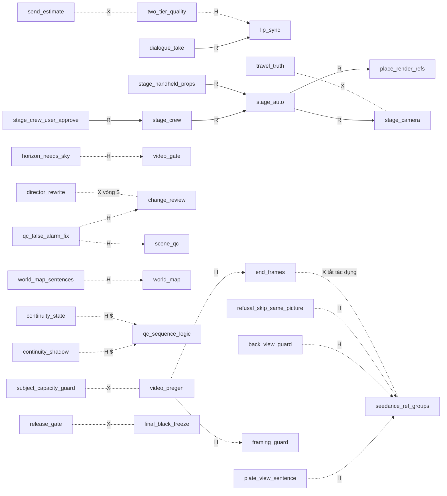

# Bằng chứng trước khi chốt cờ — 21/10/2026

> Người dùng yêu cầu 3 bằng chứng trước khi chốt đề xuất ở `docs/DANH_GIA_HIEU_QUA_CO_2026-10-21.md` (khóa 8 cờ, sửa 20 cờ, 19 cờ V3.1 mới,
> cơ chế baseline chống tắt nhầm). Tất cả đo 0 USD, chỉ đọc; chưa đổi cờ nào.

## 1. D01–D10 và quy định phân quyền V3.1 hiện hành

Nguồn: `docs/KE_HOACH_V3_1_MASTER_BUILD_2026-10-20.md` mục 4 + 4b; `data/decisions.json`.

### 1.1 Phân quyền (đang hiệu lực)
| Mục sổ | Nội dung | Ảnh hưởng tới quản lý cờ |
|---|---|---|
| `v31-permission-tiers-2026-10-20` | Đồng ý định hướng ≠ được sửa code. Cấp 1: đọc/audit, thiết kế, test chỉ đọc. Cấp 2: code — trước MỖI gói trình phạm vi file, hợp đồng dữ liệu, tác động đường cũ, regression, cờ/rollback; chỉ làm sau khi duyệt. Cấp 3 (xin riêng): migration/sửa dữ liệu production, **bật cờ ảnh hưởng workflow**, API trả phí, xóa asset, QC chặn, pilot trả phí | Khóa/tắt cờ sản xuất = **Cấp 3**; code cơ chế baseline = **Cấp 2** |
| `v31-cap2-milestone-packages-approved-2026-10-20` | M1–M4 duyệt có điều kiện; **Cấp 2 không cấp quyền** migration, xóa asset, bật cờ production, API trả phí; "cờ TẮT tương thích workflow cũ" | Cơ chế baseline không được làm đổi trạng thái cờ hiện hành |
| `v31-c3-2-flags-on-main-2026-10-20` | Ví dụ Cấp 3 đã làm đúng: bật `poll_claim`, `pause_before_submit` sau khi người dùng nói "bật theo đề xuất"; sao lưu + rollback | Mẫu thủ tục cho mỗi lần khóa/tắt cờ |
| `flag-lock-list-after-p31-2026-10-15` | Danh sách khóa thêm đợi sau #31 kiểm chứng; không đặt verified trước khi #31 xong | Quyết định khóa mới phải `replaces` mục này |
| `p27-fix-flags-on-2026-10-13` | Bật mặc định 7 cờ sửa lỗi #27 (default_on, verified False) | Giữ nguyên |

### 1.2 D01–D10 (chốt 20/10 — chính sách / định hướng, KHÔNG phải lệnh triển khai)
| Mã | Phương án | Nội dung | Sổ quyết định |
|---|---|---|---|
| D01 Tiền | A | Ngân sách dự kiến chỉ cảnh báo, không tự chặn khi allocation = 0; giữ chặn: hết tiền thật, tạm dừng, trần job/ngày autopilot, giới hạn tự gen lại. Dự toán chính xác hơn, cảnh báo rõ trước gửi, đối soát chi phí thật. Không tự đổi chính sách tiền | `v31-d01-money-policy-2026-10-20` (+ check `check_no_budget_lock_gate`) |
| D02 Provider Claude | A + khóa theo job | Job lưu provider thực tế + phiên bản cấu hình; job đang chạy không đổi provider; hết quota dừng + báo, không tự sang API trả phí; `claude_cli` = 0 USD API nhưng có giới hạn; migration tương thích dự án cũ | `v31-d02-claude-provider-per-project-2026-10-20` |
| D03 Kho chủ thể | A | Preflight kiểm sức chứa thật nếu provider cho; không xác định được → báo rõ; không tự xóa asset / đổi model ngoài quy tắc; người dùng quyết dọn; bảo vệ asset dự án khác còn tham chiếu | `v31-d03-subject-library-full-stop-2026-10-20` |
| D04 Khóa dữ liệu | B | 3 trạng thái ở CẤP TRƯỜNG; một write guard; kiểm revision (tác vụ cũ không ghi đè mới); xung đột → diff / duyệt; không sửa USER_LOCKED kể cả khi AI cho là sai; audit người/tiến trình, giờ, revision, thay đổi; Shadow trước | `v31-d04-field-level-write-guard-2026-10-20` (thay `v31-user-edit-protection-direction-2026-10-20`) |
| D05 Kho forms | A | 6 điều kiện M2.3; ảnh chuẩn Kho ưu tiên; metadata AI có provenance, không ghi đè người dùng; adapter v1/v2, schema version, regression, kiểm mọi đường đọc; backfill + API trả phí duyệt riêng | `v31-d05-kho-structured-forms-2026-10-20` (thay `v31-kho-forms-direction-2026-10-20`) |
| D06 World map | B | Không bắt buộc 3D; 3D → tọa độ thật; không 3D → 2D / quan hệ tương đối; thiếu → UNKNOWN; version, provenance, quan hệ shot, **invalidation**; duyệt trước khi chặn gen; offline #31/#33 trước | `v31-d06-scene-world-map-flexible-2026-10-20` (thay `v31-scene-world-map-trial-2026-10-20`) |
| D07 QC | A | Benchmark theo từng nhóm lỗi; kỹ thuật có bằng chứng → xét chặn sau nghiệm thu; ngữ nghĩa / góc máy / continuity / chuyển động không chắc → REVIEW; 20+20 chỉ là sàng lọc, không tự cấp BLOCK; override có người, lý do, bằng chứng, audit; bật chặn / tự sửa production duyệt riêng | `v31-d07-qc-shadow-guarded-2026-10-20` |
| D08 Fixture | A | Chỉ đọc, máy chính hoặc snapshot nhất quán (đang chạy job → snapshot); ghi SHA, cờ, schema version, model/provider, payload, thứ tự ref, hash; tách compatibility / correctness | `v31-d08-fixture-capture-readonly-2026-10-20` |
| D09 Lưu trữ | C | errors.json = định nghĩa + vòng đời; diag_events / jobs = lần phát sinh; bảng overrides CSDL. Mã bất biến; lỗi gốc ≠ lần xuất hiện; liên kết nhiều dự án; tách đã sửa code / qua test / xác minh chạy thật; không tự đóng khi chỉ có unit test; override liên kết mã lỗi / finding, người, revision; kiểm ghi đồng thời, schema, rollback; migration overrides duyệt riêng | `v31-d09-error-registry-json-overrides-db-2026-10-20` |
| D10 Phạm vi | A | Ngoài core V3.1 nhưng giữ trong định hướng dài hạn; chỉ giữ interface / extension point; không phát sinh việc / chi phí M0–M5 | `v31-d10-premiere-bg-replace-outside-core-2026-10-20` |

### 1.3 Kết luận
- Không mục nào trong D01–D10 cấp quyền tự khóa / tự tắt cờ. D07 còn nói rõ: bật chặn / tự sửa của QC cần nghiệm thu + duyệt.
- Mỗi việc: **khóa 8 cờ**, **tắt 2 cờ nguy hiểm** = Cấp 3 → một câu duyệt riêng của người dùng + mục sổ mới (`replaces` `flag-lock-list-after-p31-2026-10-15`)
  + sao lưu `data/feature_settings.json` + rollback.
- **Cơ chế baseline / cảnh báo cờ bị tắt** = code Cấp 2 → trình phạm vi (file, thứ tự `state()`, test bất biến, rollback) trước khi viết.
- Không phiên nào (kể cả phiên chính) được tự làm các việc trên.

## 2. Dependency graph + test matrix (8 cờ khóa · 20 cờ sửa · 19 cờ V3.1)

Ngày 21/10/2026. Làm trên worktree `agent-a85461c0ef97e1220` (code = main @ `002f58f7`). 0 USD, không gọi API, không sửa repo, không commit.
Mọi script/kết quả thô ở `%TEMP%\flagmatrix\` (`scan.json`, `wrappers.json`, `perflag.json`, `attrib_k8.json`, `attrib_k27.json`,
`full_*.txt/xml`, plugin `flagforce.py`).

### 2.0. Tóm tắt

| Lần chạy cả bộ (`py -m pytest -q -n 8 -p no:cacheprovider -rf -p flagforce`) | Đỏ | Qua | Ghi chú |
|---|---|---|---|
| Mốc (không ép cờ) | **1** | 6909 | `test_devsys_plan_map::test_real_plan_and_map_agree` (M4.8 chưa gắn khâu) — không liên quan cờ |
| 8 KHÓA ép BẬT (soft = đúng hiệu ứng `verified: True` dưới test) | **164** (158 id) | 6752 | 155 do cờ (kiểm lại tuần tự, tất định), 1 mốc, 2 flaky (Node browser timeout) |
| 8 KHÓA + 19 V3.1 ép BẬT | **195** (189 id) | 6721 | +33 id mới do V3.1: 31 test "cờ TẮT/đăng ký TẮT" + fixture, 1 flaky; 2 flaky cũ biến mất |

- Cách đo khớp đúng sự cố 13/10 (commit `9998b46b` đặt `verified: True` cho 20 cờ → 362 test đỏ, revert `6dd57420`): nay
  `tests/__init__.py` đặt `_TEST_BYPASS = True` nên `verified` dưới test chỉ đổi MẶC ĐỊNH sang BẬT (test tự đặt `FEATURE_X=0`/`flags_off`
  vẫn thắng). Plugin chế độ `soft` làm đúng việc đó. Khóa 8 cờ hôm nay = **155 test đỏ thật do cờ** (không phải 362), dồn vào 3 cờ:
  `video_pregen` 66, `seedance_ref_groups` 47, `chat_first` 36 (+ `framing_guard` 5, `stage_camera` 4, `plate_view_sentence` 1).
- **Không có ca nào trong 195 đỏ là lỗi sản phẩm lộ ra trực tiếp** (nhóm B thuần): tất cả là test/fixture viết cho đường cờ TẮT (nhóm A).
  Nhưng đọc code + test lộ **5 rủi ro code (nhóm B, mục 4.3)** cần sửa trước khi khóa/bật các cờ liên quan, quan trọng nhất:
  `subject_capacity_guard` ném `CapacityWait` từ `_submit_args` ở các đường gọi KHÔNG bắt lỗi (`core/runner.py:431`, `:858→1835`).
- Dependency graph: **38 cạnh quan trọng** (12 khai trong `REQUIRES`, **16 phụ thuộc ẩn** không khai, 10 xung đột/ảnh hưởng chéo).
- An toàn khóa ngay: `send_claim`, `back_view_guard` (khóa cùng/ sau `seedance_ref_groups`), `plate_view_sentence` (sửa 1 test sổ cờ).
  Sửa test trước: `video_pregen`, `seedance_ref_groups`, `chat_first`, `framing_guard`, `stage_camera` (việc C-FLAGTEST8 của cloud-C).

### 2.1. Phương pháp

1. **Đọc code**: `scan.py` quét mọi chuỗi tên cờ / `FEATURE_<NAME>` trong `.py` (ngoài `data/`…), gắn file:hàm bằng AST; `wrappers.py`
   tìm hàm bọc gọi `features.on/active/shadow/state(...)` với tên cờ hoặc hằng module (`FLAG = "..."`) và mọi chỗ gọi hàm bọc đó.
   Cạnh phụ thuộc/xung đột rút từ đọc tay các nhánh `if` quanh chỗ gọi (trích dòng trong mục 2).
2. **Cơ chế test ép cờ có sẵn**: `tests/__init__.py` (`_TEST_BYPASS=True`, `setdefault FEATURE_*=0` cho cờ verified cũ, tệp 🧪 riêng),
   `conftest.py` (tệp `FEATURE_SETTINGS_FILE` riêng mỗi worker), `tests/_flags.py` (`flags_on/flags_off/flags_trainee` ghi 🧪 thật),
   nhiều test `mock.patch("core.features.on")` (70 `flags_on(`, 55 patch `features.on`, 22 `flags_off(`).
3. **Plugin scratch `flagforce.py`** (nạp `-p flagforce`, `PYTHONPATH=%TEMP%\flagmatrix`, không sửa repo):
   - `soft`: `FEATURES[n]["verified"]=True` (BẬT) / `verified=False, default_on` bỏ (TẮT) — y như khóa thật dưới test.
   - `hard`: thay `features.state` để cờ luôn on/off bất kể test chọn gì (test tự patch `features.on` vẫn thoát) → lộ test phụ thuộc giá trị cờ.
4. **Per-flag** (`perflag.py`): mỗi cờ chạy các file test có nhắc cờ, ép `hard` TẮT rồi BẬT (junit → `perflag.json`).
   - Đỏ khi ép TẮT = test **khẳng định hành vi BẬT** (độ phủ BẬT).
   - Đỏ khi ép BẬT = test kỳ vọng TẮT (tên có off/without/before…) hoặc test tự bật-tắt trong cùng ca ("BOTH": đỏ cả hai chiều).
5. **Quy đỏ về cờ** (`attrib.py`): chạy lại đúng các id đỏ với từng cờ đơn lẻ (k8) / 8 KHÓA + từng cờ V3.1 (k27), rồi kiểm lại tuần tự
   (không xdist) để tách flaky. Lưu ý: per-flag và lần k8 chạy song song nhau → vài ca nhạy tải (`test_runner::test_concurrency_limit`,
   `test_subjects`, `test_scene_regen`) đỏ lúc tải cao, qua khi chạy tuần tự → flaky, không tính.

### 2.2. DEPENDENCY GRAPH

#### 2.2.1 Cạnh (A → B: A chỉ có tác dụng / bị chi phối khi B …)

Ký hiệu loại: **R** = khai trong `core/features.REQUIRES` · **H** = phụ thuộc ẩn (không khai, 🧪 không báo "không có tác dụng") ·
**X** = xung đột / cùng ghi một chỗ / đổi cùng gói gửi · **$** = cờ đích tốn tiền.

| # | Cạnh | Loại | Bằng chứng (file:dòng) |
|---|---|---|---|
| 1 | `dialogue_take` → `lip_sync` | R | `core/features.py:1102`; `core/runner.py:1269` `if not lipsync.enabled() or not lipsync.take_on(): return []`. `dialogue_take` verified=True (khóa) nhưng `lip_sync` mặc định TẮT → **khóa giả** |
| 2 | `stage_auto` → `stage_camera`, `place_render_refs` | R | `core/features.py:1105`; `core/stage_auto.py:99` `features.on(FLAG) and all(... REQUIRES ...)` |
| 3 | `stage_handheld_props` → `stage_auto` | R | `core/features.py:1106`; chỉ đọc trong `stage_auto.inputs_for` `core/stage_auto.py:294` |
| 4 | `stage_crew_user_approve` → `stage_crew` → `stage_auto` | R | `core/stage_crew.py:61` (chỉ gọi trong `stage_auto.py:1257/1282/1455/1514`). `stage_crew` OPT_IN TẮT ⇒ cờ default_on này **không có tác dụng** |
| 5 | `qc_team` → `scene_qc`; `change_review_frames/motion` → `change_review` | R | `core/features.py:1102`; `core/change_review.py:52` |
| 6 | `plate_view_sentence` → `seedance_ref_groups` (+ dự án `shot_mode=per_shot`) | **H** | Chỉ trên đường Seedance tham chiếu: `core/runner.py:2105` trong nhánh `self._refs(job)` → `seedance_refs.uses_refs` → `enabled()` `core/seedance_refs.py:49` (`shot_mode == "per_shot" and features.on("seedance_ref_groups")`); `seedance_refs.py:593/728`. Ngoại lệ: `core/quality_samples.py:82-87` gọi `prompt()` không qua cổng |
| 7 | `back_view_guard` → `seedance_ref_groups` | **H** | `back_view()` `core/seedance_refs.py:1347` chỉ dùng trong `shot_motion` (`:1206`), mà `shot_motion` chỉ gọi ở `:188` (đo độ dài) và `:1458` trong hàm bị chặn bởi `if not enabled(p.conn, pid): return 0` (`:1436`) |
| 8 | `end_frames` ⟂ `seedance_ref_groups` (BẬT seedance → end_frames mất tác dụng với shot đủ điều kiện) | **X** | `core/end_frames.py:32` `route = "seedance_ref" if features.on("seedance_ref_groups") and eligible(...)`; `dashboard/design/screens/trainee_ui.py:23` `NO_EFFECT_WITH`. Đây là nguồn 47 test đỏ khi khóa `seedance_ref_groups` |
| 9 | `camera_setups`, `continuous_takes`, `locomotion_end_frame` ⟂ `seedance_ref_groups` | X | `trainee_ui.py:23`; `core/known_issues.py:84`; `core/shots.py:849` (nhóm seedance thay set-up H5) |
| 10 | `video_pregen` → `framing_guard` (kiểm khoảng cách khung cuối) | H | `core/video_pregen.py:273` `if not framing_guard.enabled(): return` |
| 11 | `video_pregen` → `end_frames` (VÀNG khung cuối) | H | `core/video_pregen.py:237/239` |
| 12 | `framing_guard` → `skill_object_guard` / `locomotion_end_frame` | H | `core/end_frames.py:197`; `core/runner.py:1554` |
| 13 | `subject_capacity_guard` ↔ `video_pregen` (+ `seedance_subjects` 🔒) | **H/X** | `core/runner.py:1757-1800`: cần `seedance_subjects`; `_pregen_local` (= `video_pregen.enabled()`, `:1075`) + guard TẮT → hoãn tải (`:1759`); guard BẬT → kiểm sức chứa TRƯỚC khi hoãn, ném `CapacityWait`. Hành vi đường tải phụ thuộc cặp cờ (4 test `test_video_pregen.Batch` chỉ đỏ khi cả hai BẬT) |
| 14 | `horizon_needs_sky` → `video_gate` (+ kiểm ảnh lúc về) | H | `core/video_gate.py:83` → `plate_layout_qc.check_strict` (`core/plate_layout_qc.py:199/277`); `core/runner.py:3839` |
| 15 | `qc_false_alarm_fix` → `change_review` **hoặc** `scene_qc` (on/học việc) | H | `core/change_review.py:296` (trong `build_prompt`, chỉ chạy khi `change_review` bật); `core/qc_scene.py:134` `check_frame` ← `core/runner.py:3856/3880` (chỉ khi `qc_scene.enabled()/shadow()`) |
| 16 | `world_map_sentences` → `world_map` | H | `core/world_map.py:362` `return features.on(SENTENCE_FLAG) and enabled()` |
| 17 | `continuity_shadow`, `continuity_state` → `qc_sequence_logic` **$** | H | chỉ gọi trong `core/sequence_logic.py:178/180`, sau `if not features.on(FLAG)` (`:156`, `qc_sequence_logic` costs=True). "Bậc A 0 USD" của 2 cờ này thực ra chỉ chạy sau một lượt Claude trả tiền |
| 18 | `video_qc_shadow` → QC clip Claude (`claude_tasks.qc_video`) | H | `core/claude_tasks.py:333` trong `_measure_clip` ← `qc_video` |
| 19 | `qc_evidence`, `final_black_freeze`, `release_gate` → `final_qc.run` | H/X | `core/final_qc.py:329` (black-freeze chỉ khi `frames=True`), `:347` (qc_evidence ghi mỗi lần run); `core/release_gate.py:72` gọi `final_qc.run(frames=False)` ⇒ cổng phát hành **không bao giờ** thấy `final_black_freeze`; mỗi lần mở step5 với `release_gate`+`qc_evidence` bật là một bản ghi bằng chứng (có cache phiên) |
| 20 | `send_estimate` → `two_tier_quality`, `send_preview_panel`, `tools/pregen_check.py` | X | `core/quality_tier.py:61/71/1008/1131`; `core/send_preview.py:54`; `tools/pregen_check.py:77` (giá in ra ĐỔI theo cờ — quy ước 7b CLAUDE.md) |
| 21 | `send_preview_panel` → `chat_prompts`, `video_pregen` | H | `core/send_preview.py:91` (ghi chú D6); `:70` dựng gói với `_pregen_local=True` |
| 22 | `two_tier_quality` → `lip_sync`, `seedance_ref_groups` | H | `core/quality_tier.py:197/230` (khó/dễ theo khớp môi — G17), `:892`; `core/model_router.py:89/317` (chọn model theo cả hai) |
| 23 | `lip_sync` → chọn model/gói video | X | `core/model_router.py:317-345` (take → Seedance 2.5 720p + track giọng) |
| 24 | `director_rewrite` ↔ `change_review` (vòng) **$$** | X | ĐỎ của Tổ rà soát gọi viết lại lần 2: `core/prompt_rewrite.py:500` `propose_rewrite(..., by="change_review")`; cả hai ghi `image_prompt`/phiên bản prompt (`prompt_rewrite.py:391`) — gốc A4 #33 |
| 25 | `layout_drift_review` → `change_review` | H | `core/change_review.py:138` |
| 26 | `travel_truth` ⟂ `stage_camera` (cùng quyết máy) | X | `core/location_pack.py:446/461` cả `stage_field` (stage_camera) và `travel_of` (travel_truth) vào `plate_camera.plan_cameras` — cần thứ tự ưu tiên rõ |
| 27 | `stage_camera` → `stage_auto` (ảnh hướng dẫn) | H | `core/runner.py:2867/2875` `guide_wanted` cần cả `stage_camera` và `stage_auto.enabled()` |
| 28 | `refusal_skip_same_picture` → gửi nhóm tham chiếu (`seedance_ref_groups`) | H | `core/runner.py:2333` `if not group or not features.on(...)` |
| 29 | `whitebox_height_dummy` → `blockout_clay_sheet` / `tools/stage_grid.py` | H | `core/whitebox.py:113`, chỉ `core/blockout_clay.py:32` và tool gọi → **không nằm trên đường sản xuất** |
| 30 | `stale_code_alarm` → vòng nền `bg_poll` (Dashboard mở) | H | `core/bg_poll.py:179` |
| 31 | `bg_autoqc` → `bg_poll` **$** OPT_IN | H | `core/bg_poll.py:214` |
| 32 | `diag_merge` → mọi mã trong `MERGE_CODES` | X | `core/diag.py:132` gộp dòng ⇒ số dòng diag (mà báo cáo hiệu quả / before_run đếm) đổi |
| 33 | `scene_qc` (cả học việc) → ước tính chi + known_issues | X | `active()` ở `core/cost.py:255/738/1019`, `core/project_budget.py:199`, `core/known_issues.py:24` |
| 34 | `chat_prompts` → mọi gói gửi ảnh/video **$** | X | `core/runner.py:3128` (`chat_rewrite`), `core/cost.py:494` |
| 35 | `end_frames` (trainee) → ước tính ảnh | X | `core/cost.py:154/948` |
| 36 | `hero_takes` → ước tính video (gen thêm bản) **$ không khai** | X | `core/cost.py:309/686`, `core/autopilot.py:1200` |
| 37 | `audio_first`/`voice_check_redo`/`story_check` → TTS / Claude **$ không khai** | X | `core/autopilot.py:1704-1730` (TTS + `cast_voices` Claude), `:1671` (TTS lại), `:1681` (Claude) |
| 38 | `video_gate` ← `change_review` (autopilot giữ) | X | `core/autopilot.py:577/593` hai cổng giữ job video độc lập — cùng sinh `_Wait` |

#### 2.2.2 Đồ thị (mermaid, chỉ cạnh R + H + X chính)

#### 2.2.3 Cờ có phụ thuộc ẩn (không khai `REQUIRES`, 🧪 sẽ hiện BẬT mà không có tác dụng)

`plate_view_sentence`, `back_view_guard`, `refusal_skip_same_picture` (cần `seedance_ref_groups` + dự án per_shot) · `world_map_sentences`
(cần `world_map`) · `continuity_shadow`, `continuity_state` (cần `qc_sequence_logic` — tốn tiền) · `qc_false_alarm_fix` (cần `change_review`
hoặc `scene_qc`) · `horizon_needs_sky` (chỉ đổi kết luận `video_gate` / kiểm ảnh có render) · `video_qc_shadow` (cần QC clip chạy) ·
`whitebox_height_dummy` (chỉ đường clay/tool) · `layout_drift_review` (cần `change_review`). Đề xuất: thêm vào `REQUIRES` để `unmet_all()`
báo, đặc biệt trước khi khóa `plate_view_sentence`/`back_view_guard`.

#### 2.2.4 Cờ đổi gói gửi / chặn gen / tốn tiền (trong 47)

- Đổi gói gửi đi: `plate_view_sentence`, `back_view_guard`, `seedance_ref_groups`, `stage_camera`, `travel_truth`, `chat_prompts`,
  `motion_consistency_lint` (chỉ VÀNG), `lip_sync`/`dialogue_take`, `two_tier_quality`, `director_rewrite`, `world_map_sentences` (chỉ REVIEW, không sửa prompt), `subject_capacity_guard` (đường tải ảnh).
- Chặn/giữ gen: `video_pregen`, `video_gate`, `change_review`, `framing_guard` (bỏ khung cuối), `send_claim`, `subject_capacity_guard`, `stage_auto` (giữ ở cổng nền).
- Khai `costs: True`: `change_review`, `chat_prompts`, `bg_autoqc`, `stage_auto` (+ PAID_FLAGS: `director_rewrite`, `two_tier_quality`, `stage_camera` chữ).
- **Tốn tiền nhưng KHÔNG khai** (`before_run.costly_fix_flag` `core/before_run.py:134` không nhận ra): `hero_takes`, `audio_first`, `voice_check_redo`, `story_check`.

#### 2.2.5 Nơi đọc từng cờ

| Cờ | Nơi đọc cờ (file:hàm [kiểu] dòng) | Số chỗ gọi hàm bọc (ngoài test) |
|---|---|---|
| `send_claim` | core/send_claim.py:enabled [on] L24 | 1 |
| `video_pregen` | core/video_pregen.py:enabled [on] L37 | 7 |
| `framing_guard` | core/framing_guard.py:enabled [on] L63 | 8 |
| `plate_view_sentence` | core/seedance_refs.py:plate_view_on [on] L613 | 3 |
| `stage_camera` | core/camera_plan.py:todo_groups [on] L111 core/change_audit.py:audit_shot [on] L55 core/change_audit.py:audit_shot [on] L56 core/location_pack.py:plan [on] L461 core/location_pack.py:stage_report [on] L530 core/plate_layout_qc.py:_stage_horizon [on] L313 … +7 | 38 |
| `seedance_ref_groups` | core/end_frames.py:route [on] L32 core/seedance_refs.py:enabled [on] L49 | 12 |
| `back_view_guard` | core/seedance_refs.py:back_view [on] L1347 | 1 |
| `chat_first` | core/chat_intake.py:enabled [on] L48 | 10 |
| `video_gate` | core/video_gate.py:enabled [on] L26 | 3 |
| `two_tier_quality` | core/quality_tier.py:enabled [on] L126 dashboard/quality_ui.py:enabled [on] L42 | 41 |
| `motion_consistency_lint` | core/prompt_formula.py:consistency_on [on] L580 | 3 |
| `change_review` | core/change_review.py:enabled [on] L46 | 9 |
| `director_rewrite` | core/cost.py:rewrite_estimate [on] L474 core/pipeline.py:Pipeline._rewrite_before_retry [on] L915 core/prompt_rewrite.py:enabled [on] L59 dashboard/design/screens/prompt_versions_ui.py:busy [on] L24 | 5 |
| `chat_prompts` | core/chat_prompt.py:enabled [on] L58 core/cost.py:chat_prompt_estimate [on] L494 | 11 |
| `bg_autoqc` | core/bg_poll.py:autoqc_round [on] L214 | 1 |
| `lip_sync` | core/autopilot.py:_lipsync_phase [on] L808 core/lipsync.py:enabled [on] L33 | 17 |
| `dialogue_take` | core/lipsync.py:take_on [on] L56 | 2 |
| `end_frames` | core/end_frames.py:active [active] L578 core/end_frames.py:enabled [on] L568 core/end_frames.py:shadow [shadow] L573 core/trainee_plans.py:record_plans [shadow] L97 | 12 |
| `scene_qc` | core/known_issues.py:_per_image_qc [active] L24 core/qc_scene.py:active [active] L48 core/qc_scene.py:enabled [on] L38 core/qc_scene.py:shadow [shadow] L43 | 15 |
| `stage_auto` | core/stage_auto.py:enabled [on] L99 | 4 |
| `stage_handheld_props` | core/stage_auto.py:inputs_for [on] L294 | 7 |
| `stage_crew_user_approve` | core/stage_crew.py:user_approves [on] L61 | 0 |
| `travel_truth` | core/travel_truth.py:enabled [on] L46 | 2 |
| `continuity_layout` | core/continuity.py:_layout_on [on] L46 | 4 |
| `hero_takes` | core/hero_takes.py:on [on] L34 | 2 |
| `audio_first` | core/autopilot.py:_voice_first_phase [on] L1704 | 0 |
| `story_check` | core/autopilot.py:_story_check_phase [on] L1681 | 0 |
| `voice_check_redo` | core/autopilot.py:_check_voices [on] L1671 | 1 |
| `stale_code_alarm` | core/code_version.py:enabled [on] L22 | 4 |
| `diag_merge` | core/diag.py:_merge_on [on] L124 | 1 |
| `budget_notice_d01` | core/money_policy.py:_notice_d01 [on] L68 | 1 |
| `video_qc_shadow` | core/video_qc_shadow.py:enabled [on] L29 | 1 |
| `continuity_shadow` | core/continuity_shadow.py:enabled [on] L42 | 1 |
| `continuity_state` | core/continuity_state.py:enabled [on] L34 | 1 |
| `world_map` | core/world_map.py:enabled [on] L34 | 2 |
| `send_preview_panel` | core/send_preview.py:enabled [on] L21 | 1 |
| `qc_evidence` | core/qc_evidence.py:enabled [on] L66 | 2 |
| `repair_router` | core/repair_router.py:enabled [on] L64 | 2 |
| `release_gate` | core/release_gate.py:enabled [on] L21 | 1 |
| `horizon_needs_sky` | core/plate_layout_qc.py:check_strict [on] L277 core/plate_layout_qc.py:no_sky_reason [on] L199 | 3 |
| `qc_false_alarm_fix` | core/change_review.py:build_prompt [on] L296 core/qc_scene.py:check_frame [on] L134 | 4 |
| `send_estimate` | core/cost.py:send_estimate_on [on] L538 | 13 |
| `final_black_freeze` | core/final_qc.py:run [on] L329 | 4 |
| `subject_capacity_guard` | core/runner.py:VideoRunner._hosted_pictures [on] L1759 core/runner.py:VideoRunner._hosted_pictures [on] L1771 core/runner.py:VideoRunner._hosted_pictures [on] L1774 core/runner.py:VideoRunner._hosted_pictures [on] L1779 core/runner.py:VideoRunner._hosted_pictures [on] L1786 core/runner.py:VideoRunner._hosted_pictures [on] L1797 … +1 | 0 |
| `world_map_sentences` | core/world_map.py:sentences_enabled [on] L362 | 1 |
| `refusal_skip_same_picture` | core/runner.py:VideoRunner._refused_in_single [on] L2333 | 0 |
| `whitebox_height_dummy` | core/whitebox.py:dummy_enabled [on] L35 | 1 |

### 2.3. TEST MATRIX theo cờ (per-flag, ép `hard`)

Cột "Test khẳng định BẬT" = số test đỏ khi ép TẮT (test kiểm hành vi BẬT). "Đỏ khi ép BẬT" tách: test kỳ vọng TẮT (đường cũ) / test
tự bật-tắt trong một ca (đỏ cả hai chiều — do ép `hard`, không phải lỗi). "(khóa giả)" = `verified: True` sẵn.

| Nhóm | Cờ | Mặc định | costs | File test nhắc cờ | Số test | Ép TẮT: qua/đỏ | Ép BẬT: qua/đỏ | Test khẳng định BẬT (đỏ khi ép TẮT) | Đỏ khi ép BẬT: kỳ vọng TẮT / test tự bật-tắt |
|---|---|---|---|---|---|---|---|---|---|
| KHÓA | `send_claim` | off | — | 2 | 26 | 23/3 | 25/1 | 3 | 1 / 0 |
| KHÓA | `video_pregen` | off | — | 1 | 52 | 31/21 | 51/1 | 21 | 1 / 0 |
| KHÓA | `framing_guard` | off | — | 2 | 37 | 25/12 | 31/6 | 12 | 4 / 1 |
| KHÓA | `plate_view_sentence` | on | — | 3 | 74 | 73/1 | 71/3 | 1 | 0 / 0 |
| KHÓA | `stage_camera` | off | — | 15 | 394 | 346/48 | 391/3 | 48 | 2 / 2 |
| KHÓA | `seedance_ref_groups` | off | — | 8 | 138 | 106/32 | 134/4 | 32 | 3 / 2 |
| KHÓA | `back_view_guard` | off | — | 1 | 23 | 22/1 | 22/1 | 1 | 0 / 1 |
| KHÓA | `chat_first` | off | — | 7 | 129 | 117/12 | 111/18 | 12 | 6 / 1 |
| SỬA | `video_gate` | on | — | 3 | 65 | 54/11 | 59/6 | 11 | 4 / 0 |
| SỬA | `two_tier_quality` | off | — | 6 | 129 | 116/13 | 123/6 | 13 | 4 / 1 |
| SỬA | `motion_consistency_lint` | on | — | 2 | 58 | 54/4 | 56/2 | 4 | 0 / 2 |
| SỬA | `change_review` | off | có | 9 | 189 | 164/25 | 184/5 | 25 | 3 / 1 |
| SỬA | `director_rewrite` | off | — | 5 | 90 | 63/27 | 85/5 | 27 | 3 / 1 |
| SỬA | `chat_prompts` | off | có | 2 | 69 | 67/2 | 68/1 | 2 | 1 / 0 |
| SỬA | `bg_autoqc` | off | có | 1 | 10 | 5/5 | 9/1 | 5 | 1 / 0 |
| SỬA | `lip_sync` | off | — | 15 | 370 | 355/15 | 367/3 | 15 | 2 / 2 |
| SỬA | `dialogue_take` | on (khóa giả) | — | 4 | 68 | 60/8 | 67/1 | 8 | 1 / 1 |
| SỬA | `end_frames` | off | — | 8 | 160 | 129/31 | 154/6 | 31 | 3 / 5 |
| SỬA | `scene_qc` | off | — | 7 | 150 | 137/13 | 137/13 | 13 | 4 / 10 |
| SỬA | `stage_auto` | off | có | 4 | 187 | 149/38 | 185/2 | 38 | 2 / 1 |
| SỬA | `stage_handheld_props` | off | — | 2 | 51 | 47/4 | 50/1 | 4 | 1 / 0 |
| SỬA | `stage_crew_user_approve` | on | — | 2 | 74 | 69/5 | 73/1 | 5 | 1 / 0 |
| SỬA | `travel_truth` | off | — | 2 | 35 | 25/10 | 32/3 | 10 | 2 / 3 |
| SỬA | `continuity_layout` | off | — | 1 | 7 | 2/5 | 5/2 | 5 | 1 / 1 |
| SỬA | `hero_takes` | off | — | 1 | 7 | 2/5 | 6/1 | 5 | 1 / 0 |
| SỬA | `audio_first` | off | — | 1 | 5 | 3/2 | 4/1 | 2 | 1 / 0 |
| SỬA | `story_check` | off | — | 1 | 3 | 2/1 | 2/1 | 1 | 0 / 1 |
| SỬA | `voice_check_redo` | off | — | 1 | 27 | 27/0 | 26/1 | 0 | 1 / 0 |
| V3.1 | `stale_code_alarm` | off | — | 4 | 76 | 68/8 | 75/1 | 8 | 1 / 0 |
| V3.1 | `diag_merge` | off | — | 2 | 30 | 28/2 | 29/1 | 2 | 1 / 0 |
| V3.1 | `budget_notice_d01` | off | — | 1 | 18 | 17/1 | 17/1 | 1 | 1 / 0 |
| V3.1 | `video_qc_shadow` | off | — | 1 | 13 | 11/2 | 11/2 | 2 | 2 / 0 |
| V3.1 | `continuity_shadow` | off | — | 1 | 15 | 14/1 | 13/2 | 1 | 2 / 0 |
| V3.1 | `continuity_state` | off | — | 1 | 17 | 16/1 | 15/2 | 1 | 2 / 0 |
| V3.1 | `world_map` | off | — | 2 | 17 | 15/2 | 16/1 | 2 | 1 / 0 |
| V3.1 | `send_preview_panel` | off | — | 1 | 15 | 15/0 | 13/2 | 0 | 2 / 0 |
| V3.1 | `qc_evidence` | off | — | 1 | 22 | 18/4 | 21/1 | 4 | 1 / 0 |
| V3.1 | `repair_router` | off | — | 1 | 10 | 7/3 | 8/2 | 3 | 1 / 1 |
| V3.1 | `release_gate` | off | — | 1 | 14 | 14/0 | 13/1 | 0 | 1 / 0 |
| V3.1 | `horizon_needs_sky` | off | — | 2 | 34 | 28/6 | 33/1 | 6 | 1 / 0 |
| V3.1 | `qc_false_alarm_fix` | off | — | 2 | 36 | 23/13 | 33/3 | 13 | 2 / 1 |
| V3.1 | `send_estimate` | off | — | 2 | 39 | 32/7 | 32/7 | 7 | 3 / 5 |
| V3.1 | `final_black_freeze` | off | — | 2 | 17 | 15/2 | 15/2 | 2 | 1 / 1 |
| V3.1 | `subject_capacity_guard` | off | — | 2 | 38 | 38/0 | 38/0 | 0 | 0 / 0 |
| V3.1 | `world_map_sentences` | off | — | 1 | 6 | 5/1 | 5/1 | 1 | 1 / 0 |
| V3.1 | `refusal_skip_same_picture` | off | — | 1 | 4 | 2/2 | 3/1 | 2 | 1 / 0 |
| V3.1 | `whitebox_height_dummy` | off | — | 1 | 12 | 9/3 | 10/2 | 3 | 2 / 0 |

#### 2.3.1 Độ phủ BẬT yếu / bằng 0 (qua cờ)

- **0 test** khẳng định hành vi BẬT: `voice_check_redo`, `send_preview_panel`, `release_gate`, `subject_capacity_guard`
  (2 file test nhắc cờ nhưng tự patch `features.on` — ép cờ không đổi gì: 38/38 qua cả hai chiều; đường thật với test double Kho
  CHƯA ai thử → lộ ở lần k27, mục 4.2).
- **1 test**: `plate_view_sentence`, `back_view_guard` (test tự bật-tắt), `story_check`, `budget_notice_d01`, `continuity_shadow`,
  `continuity_state`, `world_map_sentences`.
- Mạnh: `stage_camera` (48), `stage_auto` (38), `seedance_ref_groups` (32), `end_frames` (31), `director_rewrite` (27), `change_review` (25),
  `video_pregen` (21), `lip_sync` (15).

### 2.4. Hai lần chạy CẢ BỘ — gom đỏ theo nguyên nhân

#### 2.4.1 Bảng quy đỏ về cờ (đã kiểm lại tuần tự, tách flaky)

| Cờ gây đỏ (k8) | Số test | File (số test) |
|---|---|---|
| video_pregen | 63 | test_cost_route_e1.py (14), test_not_created.py (13), test_runner.py (6), test_sent_package.py (5), test_adapters.py (3), test_job_lifecycle_b1a.py (3), test_video_references.py (3), test_quality_tier.py (2), test_scene_regen.py (2), test_video_pregen.py (2), test_concurrency_v4.py (1), test_cost.py (1), test_dashboard.py (1), test_gd1_fixes.py (1), test_seedance_refs.py (1), test_subjects.py (1), test_trash.py (1), test_v31_m13_pause_before_submit.py (1), test_v31_m47a_send_preview.py (1), test_workflow.py (1) |
| seedance_ref_groups | 42 | test_end_frames.py (13), test_framing_guard.py (8), test_locomotion_end_frame.py (5), test_camera_setups.py (3), test_v3.py (3), test_v31_t12_m12_m13_gaps.py (3), test_trial_fixes.py (2), test_gd1_fixes.py (1), test_seedance_refs.py (1), test_sent_package.py (1), test_spend_gate.py (1), test_trainee_plans.py (1) |
| chat_first | 36 | test_ui_script.py (13), test_s1443_screenwriter.py (8), test_dashboard.py (3), test_ui_storyboard.py (2), test_batch_a_0910.py (1), test_director_two_pass.py (1), test_image_progress.py (1), test_new_skills.py (1), test_next_step.py (1), test_references.py (1), test_screens_dashboard.py (1), test_step1_flow.py (1), test_ui_v2_default.py (1), test_ui_video.py (1) |
| stage_camera | 4 | test_stage_auto.py (3), test_plate_camera_stage.py (1) |
| mốc/flaky | 3 | test_mockup_ban_dung_d11.py (2), test_devsys_plan_map.py (1) |
| framing_guard | 3 | test_framing_guard.py (1), test_qc_video.py (1), test_video_pregen.py (1) |
| video_pregen+seedance_ref_groups | 3 | test_lipsync.py (1), test_runner.py (1), test_v3.py (1) |
| framing_guard+seedance_ref_groups | 2 | test_locomotion_end_frame.py (2) |
| plate_view_sentence | 1 | test_fix_flags.py (1) |
| framing_guard+stage_camera+seedance_ref_groups+chat_first | 1 | test_v3.py (1) |

| Cờ V3.1 gây đỏ thêm (k27, trên nền 8 KHÓA) | Số test | Test |
|---|---|---|
| `video_qc_shadow` | 2 | test_v31_m42_video_qc_shadow.py::test_flag_is_off_by_default test_v31_m42_video_qc_shadow.py::test_observe_flag_off_writes_nothing |
| `continuity_shadow` | 2 | test_v31_m43_continuity_shadow.py::test_flag_is_off_by_default test_v31_m43_continuity_shadow.py::test_run_flag_off_does_nothing |
| `continuity_state` | 2 | test_v31_m34_continuity_state.py::test_flag_registered_and_off test_v31_m34_continuity_state.py::test_run_flag_off_writes_nothing |
| `world_map` | 1 | test_v31_dp8_world_map.py::test_flag_off_reads_and_writes_nothing |
| `send_preview_panel` | 2 | test_v31_m47a_send_preview.py::FlagTests::test_flag_registered_and_off test_v31_m47a_send_preview.py::UiTests::test_flag_off_draws_nothing |
| `qc_evidence` | 1 | test_v31_dp4_qc_evidence.py::test_record_flag_off_writes_nothing |
| `repair_router` | 2 | test_v31_dp5_repair_router.py::test_apply_qc_decision_and_jobs_are_the_same_with_the_router test_v31_dp5_repair_router.py::test_observe_flag_off_does_nothing |
| `release_gate` | 1 | test_v31_dp6_release_gate.py::test_flag_off_by_default |
| `horizon_needs_sky` | 1 | test_v31_dp2_horizon_needs_sky.py::test_flag_off_keeps_the_false_alarm |
| `qc_false_alarm_fix` | 3 | test_v31_dp1_qc_false_alarms.py::test_flag_off_keeps_the_old_false_alarm test_v31_dp1_qc_false_alarms.py::test_flag_off_review_prompt_is_byte_identical test_v31_dp1_qc_false_alarms.py::test_review_prompt_carries_the_reference_video |
| `final_black_freeze` | 2 | test_v31_dp3_final_black_freeze.py::test_flag_is_off_by_default test_v31_dp3_final_black_freeze.py::test_run_only_with_the_flag |
| `subject_capacity_guard` | 9 | test_ref_mark_off_face.py::RefMarkOffFaceTest::test_kho_full_fallback_marks_the_end_frame_like_the_other_pictures test_ref_mark_off_face.py::RefMarkOffFaceTest::test_real_person_refusal_of_unmarked_subject_library_pictures_goes_down_the_ladder test_ref_mark_off_face.py::RefMarkOffFaceTest::test_start_frame_never_eye_marked test_seedance_refs.py::SeedanceRefTests::test_subject_library_flag_sends_unmarked_pictures_by_asset_uri_uploaded_once test_seedance_refs.py::SeedanceRefTests::test_subject_library_refusal_falls_back_to_marked_pictures_and_says_so test_video_pregen.py::Batch::test_pregen_fingerprint_uses_clean_upload_pixels test_video_pregen.py::Batch::test_seedance_real_reference_path_checks_before_upload test_video_pregen.py::Batch::test_upload_after_check_and_same_input_redo_never_uploads test_video_pregen.py::Batch::test_upload_file_error_holds_only_its_job |
| `world_map_sentences` | 1 | test_v31_dp11_position_sentence.py::test_flag_off_review_does_nothing |
| `whitebox_height_dummy` | 3 | test_v31_m32_height_dummy.py::test_flag_off_is_the_old_whitebox test_v31_m32_height_dummy.py::test_flag_registered_and_off test_whitebox.py::WhiteboxTests::test_people_stand_where_the_camera_says |

Tổng k8: 155 id do cờ + 1 mốc (`test_devsys_plan_map`) + 2 flaky (`test_mockup_ban_dung_d11::test_browser_stage_editor[*]`,
`subprocess.TimeoutExpired` Node khi máy tải cao). Khi chạy tuần tự: `video_pregen` 66 đỏ / 66, `seedance_ref_groups` 47/48, `chat_first`
36/37, `framing_guard` 5/7, `stage_camera` 4/5, `plate_view_sentence` 1/2, `back_view_guard` **0/3**, `send_claim` **0**.
Tổng k27 thêm 33 id: 32 quy về 14 cờ V3.1 (bảng trên) + 1 flaky (`test_feature_settings::TraineeModeTests::test_modes_never_leak_into_flags`,
qua khi chạy tuần tự với đủ 27 cờ). 5 cờ V3.1 không làm đỏ thêm gì: `stale_code_alarm`, `diag_merge`, `budget_notice_d01`,
`send_estimate`, `refusal_skip_same_picture`.

#### 2.4.2 Nhóm A — test ngầm dựa cờ TẮT (sửa test, không sửa code)

| Cờ | Kiểu đỏ (thông điệp tiêu biểu) | Vì sao là A | Cách sửa test gợi ý |
|---|---|---|---|
| `video_pregen` (66) | job ở `queued` thay vì `running/succeeded`; `[] != ['mock-1']`; `TypeError ... NoneType` (bước sau dùng clip chưa có) | Fixture không có tệp ảnh thật / khung đầu ≠ ảnh duyệt hiện hành → lớp kiểm trước gen giữ ĐỎ **đúng thiết kế** ("không gửi khi chưa kiểm được"). Bằng chứng: `WAIT_REASONS={2: 'kiểm trước gen chặn: không đọc được tệp ảnh khung đầu đã duyệt (.../images/job_1.png) · không đọc được tệp tham chiếu ...'}` (`test_runner::test_project_video_model_is_passed_to_provider`) | thêm `os.environ.setdefault("FEATURE_VIDEO_PREGEN","0")` vào `tests/__init__.py` như 11 cờ verified cũ (test riêng `test_video_pregen.py` đã tự bật), hoặc fixture ghi PNG thật; sửa `Registry::test_flag_default_off_and_declared` |
| `seedance_ref_groups` (47) | `'One continuous take ...' not found`, `None is not true` (khung cuối), `[] != [1,3]` | Shot `per_shot` đủ điều kiện đi tuyến tham chiếu → **không có khung cuối / set-up H5** theo thiết kế (cạnh 8–9). Test viết cho tuyến first_last | `flags_off(self, "seedance_ref_groups")` trong các lớp test end-frame / camera_setups / locomotion / framing RunnerEndFrame / v3 Budget; hoặc `setdefault FEATURE_SEEDANCE_REF_GROUPS=0` |
| `chat_first` (36) | `KeyError: 'btn_analyse_1'`, `'script-cta-lock_1' not found`, `'v2-empty' not found` | Màn Kịch bản đổi sang khung chat; test AppTest giữ widget key của màn cũ | `flags_off(... "chat_first")` cho lớp test màn cũ, hoặc viết lại key; `test_next_step` đổi chữ mong đợi |
| `framing_guard` (5) | `True is not false` (sổ cờ), `0.97 not <= 0.5` (`test_qc_video::FramingCap::test_framing_flag_caps_score`), VÀNG `khung_cuoi` "không đo được khoảng cách" (`test_video_pregen::EndFrame::test_pass_ready_end_frame_matching_byd`), 2 `test_locomotion_end_frame` (khung cuối bị bỏ) | Khi framing_guard bật, trần điểm chỉ ghi diag, giữ điểm gốc (R15 — `test_cap_keeps_original_scores_for_trust` khẳng định đúng điều này); ảnh fixture trơn → đo không được → bỏ khung cuối người đang chạy (đúng luật `runner.py:1497`) | ghim `flags_off("framing_guard")` trong 4 test; sửa test sổ cờ |
| `stage_camera` (4) | `test_flag_declared_off_by_default`, `test_needs_stage_camera_and_place_refs`, `test_g0_skips_staged_shots_when_stage_auto_off`, `test_stage_report_does_not_hold_a_staged_scene` | Test giả định stage_camera TẮT để kiểm REQUIRES/khác nhánh | `flags_off("stage_camera")` trong 3 test + sửa sổ cờ |
| `plate_view_sentence` (1) | `test_fix_flags::FixesProjectsDeclared::test_p27_flags_default_on_by_user_decision` `True is not false` | Test đòi cờ default_on còn `verified=False` | đổi test khi khóa |
| V3.1: `video_qc_shadow`, `continuity_shadow`, `continuity_state`, `world_map`, `world_map_sentences`, `send_preview_panel`, `qc_evidence`, `repair_router`, `release_gate`, `horizon_needs_sky`, `qc_false_alarm_fix`, `final_black_freeze`, `whitebox_height_dummy` (23 ca) | `test_flag_is_off_by_default` / `test_flag_registered_and_off` (`assert not True`), `*_flag_off_writes_nothing` (bản ghi khác None), `test_flag_off_keeps_the_false_alarm`, `test_flag_off_review_prompt_is_byte_identical`, `repair_router ... (1 > 0) == ('off' == 'on')`, `send_preview UiTests::test_flag_off_draws_nothing` (`MagicMock.__format__`) | Đều là test ghim đường TẮT / khai "mặc định TẮT" | khi bật/khóa: đổi test sổ cờ + `flags_off` trong ca "flag off" |
| `whitebox_height_dummy` — `test_whitebox::test_people_stand_where_the_camera_says` | `[0,0,3.674] != [0,0,3.6]` | Cờ cố ý đặt điểm nhìn ở tầm mắt người nộm (2.0 + 1.674 thay 2.0 + 1.6) — đổi hình học có chủ đích | cập nhật số mong đợi khi bật; cờ không nằm trên đường sản xuất (cạnh 29) |
| `subject_capacity_guard` (9) | `core.subjects.CapacityWait: VÀNG: chưa xác minh được sức chứa Kho chủ thể — giữ job CHỜ` (5: `test_ref_mark_off_face` ×3, `test_seedance_refs` subject_library ×2); `0 != 1` / `'file disappeared' not found` (4: `test_video_pregen.Batch`, chỉ đỏ khi `video_pregen` cũng BẬT) | Ở mức test là A: test double Kho chủ thể không có API sức chứa → guard giữ CHỜ (fail-closed đúng ý). **Nhưng** lộ đường code rủi ro B1 dưới đây | double Kho thêm `capacity` READY; ghim `flags_off` ở test đường cũ |

#### 2.4.3 Nhóm B — lỗi thật / rủi ro code khi BẬT (file:dòng)

Không ca nào trong 195 đỏ là lỗi sản phẩm thuần; các mục dưới là lỗi/rủi ro đọc code, có bằng chứng test hoặc trích dòng. B1–B3 phải sửa
code trước khi khóa/bật cờ tương ứng.

| # | Cờ | Lỗi / rủi ro | Bằng chứng | Mức chắc |
|---|---|---|---|---|
| **B1** | `subject_capacity_guard` | `CapacityWait` (lớp con `ValueError`, `core/subjects.py:351`) ném từ `_hosted_pictures` (`core/runner.py:1775/1780/1789/1798`) lan qua `_submit_args`. Chỉ được bắt ở vòng gửi (`runner.py:478-482`, `:466-471`, `:497-500` → `_pregen_prepare_error` `:1082`). **Không bắt** ở: (a) `runner.py:431` `stale = self._blocked(job)` cho job ĐÃ có `external_id` (đã trả tiền) → `_blocked` → `_ref_lint` `:1207` → `_submit_args` — lỗi văng làm hỏng cả lượt `_submit_pending`; (b) `relink_failed` `:858` → `_find_real` `:1835` → `_submit_args`. Ngoài ra ở các đường này `_pregen_local=False` nên guard gọi Kho thật (kiểm sức chứa/tải ảnh) chỉ để lint | Test chứng minh `_submit_args` ném thẳng `CapacityWait` khi guard BẬT (5 test, mục 4.2); đường (a)(b) đọc code, chưa tái hiện bằng test | Cao (ném chắc chắn); hậu quả ở (a)(b) = đọc code |
| **B2** | `dialogue_take` 🔒 + `lip_sync` | Khóa giả: `verified=True` nhưng tác dụng cần `lip_sync` (mặc định TẮT) — `core/runner.py:1269`; `core/features.py:1102`. Máy không có `FEATURE_LIP_SYNC=1` → cờ "khóa BẬT" không làm gì. `tests/__init__.py` còn `setdefault FEATURE_DIALOGUE_TAKE=0` | perflag: `dialogue_take` 8 test khẳng định BẬT đều tự bật `lip_sync` | Chắc |
| **B3** | `change_review` | Fail-open G35 (Claude lỗi/hết tiền mà cổng giữ vẫn mở) — đã ghi ở `docs/DANH_GIA_HIEU_QUA_CO_2026-10-21.md` 4.2; vòng với `director_rewrite` (`core/prompt_rewrite.py:500`) + ghi đè prompt người chỉnh (A4) | Tài liệu đánh giá; cạnh 24 | Chắc (đã xảy ra thật) |
| B4 | `seedance_ref_groups` ⟂ `end_frames` / `locomotion_end_frame` / `camera_setups` | Khóa `seedance_ref_groups` làm mọi kiểm/vẽ khung cuối mất tác dụng với shot per_shot đủ điều kiện (`core/end_frames.py:32`). Không phải bug nhưng là **quyết định sản phẩm** phải chốt trước khi khóa (47 test đỏ chính là các hành vi này) | k8 + perflag | Chắc |
| B5 | `hero_takes`, `audio_first`, `voice_check_redo`, `story_check` | Tốn tiền (gen thêm clip / TTS / Claude) nhưng không khai `costs: True` → `before_run.costly_fix_flag` (`core/before_run.py:134-140`) coi là 0 USD | `core/autopilot.py:1200,1671,1681,1704-1730`; `core/hero_takes.py:147` | Chắc |
| B6 | `plate_view_sentence`, `back_view_guard`, `world_map_sentences`, `continuity_shadow/state`, `qc_false_alarm_fix`, `refusal_skip_same_picture` | Phụ thuộc ẩn (mục 2.3) → 🧪 báo BẬT mà không tác dụng; `continuity_shadow/state` thực chất chỉ chạy sau lượt Claude trả tiền | cạnh 6,7,15–17,28 | Chắc |
| B7 | `release_gate` + `final_black_freeze` | Cổng phát hành gọi `final_qc.run(frames=False)` (`core/release_gate.py:72`) nên không bao giờ thấy đen/đứng hình (`core/final_qc.py:326-330`) | đọc code | Chắc |
| B8 | `travel_truth` ↔ `stage_camera` | Hai nguồn quyết máy cùng vào `plate_camera.plan_cameras` (`core/location_pack.py:446-461`); ưu tiên khi cả hai bật chưa có test (perflag `travel_truth`: 3 test tự bật-tắt) | đọc code | Trung bình |
| B9 | `video_pregen` × `two_tier_quality` | Ở `test_cost_route_e1` (bản cao nâng từ nháp) pregen giữ: "khung đầu sắp gửi (i.png) không phải ảnh ĐÃ DUYỆT hiện hành của shot (job 1)". Ở test là fixture, nhưng cần phát lại 0 USD trên gói bản cao thật #33 để chắc đường nâng 1080p không bị giữ nhầm | dump `WAIT_REASONS` (flagforce `FLAGMATRIX_DUMP=1`) | Thấp–trung bình |

### 2.5. Kết luận theo cờ

Nhãn: ✅ an toàn khóa/bật ngay · 🧪 sửa test trước (code đúng) · 🔧 sửa code trước · ⏸ chờ quyết định / bằng chứng thật.

#### 2.5.1 Tám cờ KHÓA

| Cờ | Kết luận | Bằng chứng |
|---|---|---|
| `send_claim` | ✅ khóa ngay | 0 test đỏ ở cả hai lần chạy cả bộ; 3 test khẳng định BẬT; không phụ thuộc cờ khác |
| `back_view_guard` | ✅ khóa ngay (khóa cùng/sau `seedance_ref_groups`; thêm REQUIRES) | 0 đỏ thật (3 ca quy cho nó đều flaky, kiểm lại tuần tự qua); tác dụng chỉ trên tuyến seedance (cạnh 7) |
| `plate_view_sentence` | ✅ sau khi sửa 1 test (`test_fix_flags::test_p27_flags_default_on_by_user_decision`) | 1 đỏ (sổ cờ); đã default_on; phụ thuộc ẩn `seedance_ref_groups` |
| `stage_camera` | 🧪 4 test | `test_stage_auto.py` ×3, `test_plate_camera_stage.py` ×1; 48 test khẳng định BẬT — phủ tốt |
| `framing_guard` | 🧪 5 test | mục 4.2; cạnh 10/12 với `video_pregen`/`locomotion_end_frame` |
| `chat_first` | 🧪 36 test UI | chỉ giao diện, không đụng gói gửi/tiền |
| `seedance_ref_groups` | ⏸ chốt B4 (khung cuối) rồi 🧪 47 test | đổi tuyến video thật; nhiều cờ khác bám vào nó (6, 7, 8, 9, 22, 28) |
| `video_pregen` | 🧪 66 test (lớn nhất) + phát lại B9 | fixture không tệp thật bị giữ đúng thiết kế |

#### 2.5.2 Hai mươi cờ SỬA

| Cờ | Kết luận | Lý do chính |
|---|---|---|
| `video_gate` | ⏸ khóa ngay sau `horizon_needs_sky` (cạnh 14) + 🧪 2 test `test_fix_flags::BeforeRunFixFlags` dùng nó làm ví dụ cờ tắt | 11 test khẳng định BẬT |
| `two_tier_quality` | 🔧 nhãn + ước tính (cạnh 20, 22: phụ thuộc `send_estimate`, `lip_sync` G17) | 13 test BẬT; `test_before_run::test_paid_flags_on_are_listed` kỳ vọng tắt |
| `motion_consistency_lint` | ✅ về code (chỉ VÀNG); 🧪 2 test tự bật-tắt | default_on |
| `change_review` | 🔧 B3 fail-closed trước | costs; vòng với `director_rewrite` |
| `director_rewrite` | 🔧 không ghi đè trường người khóa (A4) | 27 test BẬT |
| `chat_prompts` | 🔧 `pregen_check` dựng gói có D6 (G29); giữ tắt khi provider hết tiền | costs |
| `bg_autoqc` | ⏸ không khóa (OPT_IN, tự tiêu tiền) | |
| `lip_sync` | 🔧 khóa CÙNG `dialogue_take` sau 1 shot thật (B2) | 15 test BẬT |
| `dialogue_take` | 🔧 B2 khóa giả: hoặc khóa cả `lip_sync`, hoặc bỏ `verified` | |
| `end_frames` | ⏸ học việc; phụ thuộc quyết định B4 | 31 test BẬT; 5 test tự bật-tắt |
| `scene_qc` | ⏸ học việc; 10 test tự bật-tắt/học việc — chưa khóa được | `active()` đổi cả ước tính chi (cạnh 33) |
| `stage_auto` | ⏸ sau `stage_camera` + `place_render_refs` khóa; costs | 38 test BẬT |
| `stage_handheld_props` | ⏸ OPT_IN, phụ thuộc `stage_auto` | |
| `stage_crew_user_approve` | 🔧 default_on mà không tác dụng (`stage_crew` OPT_IN TẮT) | cạnh 4 |
| `travel_truth` | 🔧 làm rõ ưu tiên với `stage_camera` (B8) | 10 test BẬT |
| `continuity_layout` | ✅ về code (VÀNG); 🧪 1 test tự bật-tắt | 5 test BẬT |
| `hero_takes` | 🔧 khai `costs: True` (B5) | |
| `audio_first` | 🔧 khai costs (B5) | 2 test BẬT |
| `story_check` | 🔧 khai costs (B5); độ phủ 1 test | |
| `voice_check_redo` | 🔧 khai costs (B5); **0 test** khẳng định BẬT | |

#### 2.5.3 Mười chín cờ V3.1

| Cờ | Kết luận | Ghi chú |
|---|---|---|
| `stale_code_alarm`, `diag_merge`, `budget_notice_d01`, `send_estimate`, `refusal_skip_same_picture` | ✅ về test: bật cùng 8 KHÓA không làm đỏ thêm gì | `diag_merge` đổi số dòng diag (cạnh 32); `send_estimate` đổi giá `pregen_check` (cạnh 20); `refusal_skip_same_picture` đổi thứ tự người dùng chốt 27/09 → vẫn phải hỏi người dùng |
| `video_qc_shadow`, `continuity_shadow`, `continuity_state`, `world_map`, `send_preview_panel`, `qc_evidence`, `repair_router`, `release_gate`, `horizon_needs_sky`, `qc_false_alarm_fix`, `final_black_freeze`, `world_map_sentences` | 🧪 1–3 test "mặc định TẮT/đường TẮT" mỗi cờ khi bật | không lỗi thật; lưu ý phụ thuộc ẩn (B6) và B7 (`release_gate` không thấy `final_black_freeze`) |
| `whitebox_height_dummy` | 🧪 3 test (gồm `test_whitebox` hình học đổi có chủ đích) | ngoài đường sản xuất |
| `subject_capacity_guard` | 🔧 B1 trước (bắt `CapacityWait` ở `runner.py:431` và `relink_failed`), + test double Kho có `capacity`, + test cặp với `video_pregen` | 0 test khẳng định BẬT qua cờ |

### 2.6. Giới hạn

- Ép cờ chỉ qua `features.state`/`FEATURES` — test tự `mock.patch("core.features.on")` không bị ảnh hưởng (độ phủ của chúng không đo được bằng cách này, vd `subject_capacity_guard`).
- Phân loại A/B dựa thông điệp lỗi + kiểm lại tuần tự + đọc code mẫu; không đọc từng test trong 155 ca của nhóm `video_pregen`/`seedance_ref_groups`/`chat_first` (mẫu đã xem nhất quán).
- B1(a)(b), B7, B8 là đọc code, chưa có test tái hiện. Không chạy gì trên dữ liệu thật / API.
- Lần k8 và per-flag chạy song song nhau (máy tải cao) → đã tách flaky bằng chạy lại tuần tự.

## 3. Rủi ro khi đổi thứ tự ưu tiên trong `features.state()`

Mô phỏng trên BẢN SAO cài đặt cờ thật của máy chính (script dựng lại `state()` theo lớp, đã kiểm khớp `state()` thật trên cả 144 cờ).

0 USD, chỉ đọc. Code đọc ở `D:\AI-Video-Pipeline` (HEAD `0655c434`). Dữ liệu mô phỏng là bản sao trong `%TEMP%\staterisk\`:
`feature_settings.main.json` (bản sao `data/feature_settings.json`), `dashboard_env_FEATURE_only.txt` (chỉ 36 dòng `FEATURE_` của dashboard.env),
`backups/` (25 bản sao lưu). Script: `sim.py`, `probe.py`, `probe2.py`. Kết quả thô: `ket_qua.json`, `ket_qua_probe2.json`, baseline chụp được:
`baseline_from_main.json`. Script **dựng lại state() bằng các lớp** và tự kiểm: mô hình "HIỆN TẠI" khớp `features.state()` thật trên đủ 144 cờ (có `assert`).

### 3.1. Thứ tự hiện tại (file:dòng, `core/features.py`)

| Hàm | Dòng | Thứ tự / hành vi |
|---|---|---|
| `settings()` | 912–936 | Đọc `settings_path()` (897: `FEATURE_SETTINGS_FILE` hoặc `<repo>/data/feature_settings.json`), cache theo mtime. `flags` = bool; `modes` chỉ nhận `"trainee"` cho cờ có `trainee: True` và không có trong `flags`; cờ REMOVED → `dropped` |
| `state()` | 1040–1072 | 1) `REMOVED` → off · 2) `locked()` → on · 3) 🧪 `modes` → trainee · 4) 🧪 `flags` → on/off · 5) preset `stable` → on chỉ khi `verified`; `experimental` → env=0 thì off, cờ học việc → trainee, `OPT_IN_ONLY`/`HARMFUL` → off trừ env=1 · 6) env `FEATURE_X`: cờ học việc + (=1 hoặc =trainee) → trainee; =1 → on; =0 hoặc =trainee → off · 7) `default_state()` |
| `default_state()` | 1075–1081 | REMOVED → off; `verified` hoặc `default_on` → on; còn lại off |
| `locked()` | 1009–1011 | `verified` và không REMOVED và không `_lock_bypassed()` |
| `_lock_bypassed()` | 1002–1006 | `_TEST_BYPASS is True` — chỉ `tests/__init__.py:15` đặt |
| `locked_off_ignored()` | 1019–1037 | Chỉ BÁO lựa chọn tắt/học việc cũ của cờ khóa (🧪 hoặc env=0) — bị bỏ qua. Máy chính hiện: **0** |
| `on()` / `shadow()` / `active()` | 1084 / 1090 / 1095 | `state()=="on"` / `=="trainee"` / `!="off"` |
| `OPT_IN_ONLY` | 879–880 | 14 cờ tự tiêu tiền: preset experimental không bật; chỉ 🧪 hoặc env=1 bật |
| `REMOVED` | 884–893 | 5 cờ, luôn off |
| `source()` | 1200–1211 | Cùng thứ tự: removed/locked/settings/preset/env/default |
| `save_settings()` | 939–990 | Ghi nguyên tử (tmp + `os.replace`). Từ chối tắt/học việc cờ khóa (kiểm hết trước khi ghi). `None` = xóa lựa chọn riêng. **Không sao lưu** |

Env đi vào tiến trình thế nào: `tools/launch_dashboard.ps1:57–63` nạp `dashboard.env` (ghi đè biến Process); script dùng
`core/adapters/check.py:48 load_dashboard_env()` (`setdefault`, môi trường thắng). Script **không** gọi hàm đó thì không thấy dòng `FEATURE_`:
trên máy chính đã lệch **13 cờ** ngay hôm nay (lip_sync, j_cut, seedance_ref_groups, audio_first… và 4 học việc → off).

#### Mọi đường GHI trạng thái cờ
- `features.save_settings` (lõi duy nhất ghi `data/feature_settings.json`):
  - `dashboard/header.py:684` chọn preset · `:727` công tắc từng cờ (🧪) · `:732–733` nút **"↺ Bỏ mọi lựa chọn riêng (theo preset)"**:
    `flags={k: None…}`, `modes={k: None…}` — một bấm, không hỏi lại, không sao lưu.
  - `dashboard/design/screens/trainee_ui.py:35` chế độ bật/học việc/tắt của cờ học việc.
  - `core/before_run.py:144–149` `enable_fix_flags` (nút "Bật các cờ sửa lỗi" ở 🧭 — chỉ ghi True, chỉ cờ 0 USD).
  - `tests/_flags.py` (`flags_on/off/trainee/clear`) — ghi tệp 🧪 của lượt test (tệp tạm).
- Env: `dashboard.env` (36 dòng FEATURE_, sửa tay), biến môi trường; `tests/__init__.py:5,16–21` (`setdefault` FEATURE_SETTINGS_FILE rỗng + 11 cờ =0 + `_TEST_BYPASS=True`);
  `tests/conftest.py:21` (tệp 🧪 riêng mỗi lượt/worker); ~44 tệp test tự `FEATURE_SETTINGS_FILE`/`save_settings`.
- Đổi tệp 🧪 mà tiến trình đọc: `tools/pregen_check.py:162–183` + `tools/replay_payload.py:180–188, 312–317` (CHÉP tệp thật vào thư mục thử),
  `tools/golden_db_replay.py:360`, `tools/ui_snapshot.py:338`, `tools/ui_v2_acceptance.py:371` (tệp rỗng).
- Chép tay/khôi phục bản sao lưu `data/backup/feature_settings.*`, `data/feature_settings.backup_*` (25 bản; không có bản nào ghi `false` cho cờ khóa).
- Code: sửa `verified` / `default_on` / `REMOVED` / `OPT_IN_ONLY` trong `FEATURES`.

### 3.2. Mô phỏng

Trạng thái hiệu lực hiện nay (máy chính = tệp 🧪 + dòng FEATURE_ dashboard.env): **115 bật · 6 học việc · 23 tắt**; nguồn: 84 🧪, 23 khóa, 13 env, 24 mặc định.
Preset `custom`, 86 lựa chọn (đều True) + 2 học việc (`qc_team`, `scene_qc_trusted`). Máy trống (không tệp 🧪, không env): 31/0/113.
Bộ test (không tệp, 11 cờ env=0, `_TEST_BYPASS`): 20/0/124.

Baseline = trạng thái hiệu lực máy chính chụp lúc này (144 mục). Thứ tự thử (REMOVED luôn đứng đầu):

- **A** 🧪 > khóa > baseline > preset > env > mặc định
- **B** khóa > 🧪 > baseline > preset > env > mặc định
- **C** baseline > khóa > 🧪 > … (cố ý sai)
- **D** khóa > 🧪 > preset > env > baseline > mặc định (đúng đề xuất mục 5 của DANH_GIA: baseline đọc trong `default_state()`)
- **E** = D + bảo vệ: baseline chỉ lấp chỗ trống; không bao giờ BẬT (kể cả học việc) cờ `OPT_IN_ONLY` hoặc `costs`; cờ có chế độ học việc
  tối đa `trainee`; tắt hẳn khi `_TEST_BYPASS` hoặc `FEATURE_BASELINE=0`
- **F** = E nhưng chỉ dùng baseline khi máy **không có** tệp `data/feature_settings.json` (baseline = "hạt giống" cho máy mới)

Số cờ ĐỔI trạng thái hiệu lực so với hiện tại:

| Ngữ cảnh | A | B | C | D | E | F |
|---|---|---|---|---|---|---|
| Máy chính (Dashboard, có dashboard.env) — baseline vừa chụp | **0** | **0** | **0** | **0** | **0** | **0** |
| Máy chính, script không nạp dashboard.env | 13 | 13 | 13 | 13 | 13 | 0 |
| Máy trống (worktree/cloud/Codex) | 90 | 90 | 90 | 90 | 68 | 68 |
| … trong đó cờ tốn tiền/OPT_IN bị bật | **22** | **22** | **22** | **22** | **0** | **0** |
| Bộ test (tests/__init__.py) | 101 | 101 | 101 | **90** | 0 | 0 |
| Máy chính sau khi `git pull` một baseline mới bật thêm 3 cờ đang tắt mặc định | 3 | 3 | 3 | 3 | 3 | **0** |
| Máy chính nếu "tỉa" tệp 🧪 chỉ còn chỗ khác baseline (mục 5.1 đề xuất) | 0 | 0 | 0 | 2 | **24** | **76** |

"0 trên máy chính" ở cả A/B/C là **tự nhiên** (baseline = chính trạng thái hiện tại) — nó không chứng minh thứ tự an toàn. Khác biệt chỉ lộ ra khi
có thay đổi về sau (mục 3). Máy chính hôm nay không có cờ khóa nào bị 🧪 ghi tắt nên A cũng ra 0; nhưng A cho 🧪 thắng khóa — một tệp cũ / sửa tay
`"x": false` sẽ tắt cờ 🔒 (đảo luật 15/10).

22 cờ tốn tiền bị bật trên máy trống ở A–D: ambient_motion, anchor_by_spot, asset_english_names, auto_send_self_fix, bg_autoqc, blockout_clay_sheet,
camera_match_qc, change_review, change_review_frames, change_review_motion, chat_prompts, continuity_from_ui, director_blockout, end_state_fresh,
film_grammar_check, kld_lessons_prompts, layout_from_follow, motion_sfx, p24_lessons, qc_observe_enum, shot_popup, stage_handheld_props
(13 trong `OPT_IN_ONLY`, có `bg_autoqc`/`auto_send_self_fix` = vòng nền tự gửi job tốn tiền không ai bấm).

### 3.3. Kịch bản rủi ro

| # | Kịch bản | Kết quả mô phỏng | Kết luận |
|---|---|---|---|
| S1 | Người dùng tắt tay ở 🧪 một cờ có trong baseline (`package_overrides`) | A/B/D/E/F: còn TẮT · **C: BẬT lại** | Lựa chọn riêng phải đứng trên baseline |
| S2 | Baseline cũ (dựng từ bản 12/10, hoặc 20/10 trước C3-2) + lựa chọn hiện nay | A/B/D/E/F: 0 cờ đổi · **C: 61 cờ / 2 cờ tắt mất** | Baseline cũ chỉ vô hại khi đứng dưới 🧪 |
| S2b | Tệp 🧪 lùi về bản 12/10 (khôi phục nhầm) | Hiện nay: 61 cờ lệch; A/B/C: 0; D: 1; E: 17; F: 61 | Baseline giảm thiệt hại khôi phục nhầm, nhưng cũng che mất việc khôi phục |
| S3 | dashboard.env `FEATURE_VOICE_CHECK_REDO=0` (cờ đang bật nhờ env) | Hiện tại: off · D/E/F: off · **A/B/C: vẫn BẬT** (baseline đè env) | Baseline đặt trên env làm dòng `=0` vô tác dụng |
| S3b | env `=1` cho cờ baseline ghi tắt (`subject_capacity_guard`) | D/E/F: on · **A/B/C: off** | Như trên |
| S3c | Xóa một dòng `FEATURE_X=1` / bấm "bỏ lựa chọn riêng" một cờ để TẮT nó | D/E: cờ rơi về baseline = vẫn BẬT (không còn về mặc định code) | Đổi ngữ nghĩa "xóa lựa chọn": phải ghi rõ trong 🧪 |
| S4 | Nút "↺ Bỏ mọi lựa chọn riêng" | Hiện tại: **76 cờ đổi** (đều về tắt). A/B/C: 0 · D: 2 (scene_qc, end_frames → học việc vì env) · E: 24 (22 cờ tốn tiền về tắt + 2 học việc) · F: 76 | Baseline làm nút đỡ nguy hiểm hơn; vẫn cần xác nhận + sao lưu |
| S4b | Bỏ lựa chọn riêng rồi chọn preset "Ổn định" | Hiện tại 23 bật; D/E/F: 23 (đúng preset) · **A/B/C: 115 bật — preset chết** (98 cờ lệch) | Baseline phủ đủ 144 cờ mà đặt trên preset/env thì mọi lớp dưới thành vô tác dụng |
| S5 | Cờ mới thêm vào code sau lần chụp baseline | Không có trong baseline → rơi về env/mặc định (tắt) | Baseline không giải quyết "cờ mới sinh ra tắt" (kịch bản 1 DANH_GIA) |
| S6 | Cờ học việc / OPT_IN / costs bị baseline bật nhầm trên máy khác | A–D: **22 cờ tốn tiền bật**; E/F: 0. Học việc: baseline có 6 trainee, không cờ nào `costs`; E/F hạ `scene_qc`, `end_frames` (bật thật ở máy chính nhờ 🧪) xuống học việc | Bảo vệ bắt buộc. Lưu ý: học việc vẫn CHẠY vai (vd scene_qc/qc_team gọi Claude — nay qua claude_cli) |
| S7 | Bộ test | A/B/C: 101 cờ đổi (đè cả env=0 của tests/__init__) · D: 90 · E/F: 0 | D lặp lại vụ 13/10 (revert 362 test đỏ). `tests/test_feature_settings.LockedVerifiedTests` đặt `_TEST_BYPASS=False` → khi đó điều kiện "tắt khi bypass" mất tác dụng: cần thêm `FEATURE_BASELINE_FILE` trỏ tệp rỗng trong `tests/__init__.py` |
| S8 | `git pull` baseline mới (sinh ở máy khác hoặc bật thêm cờ) | A–E: cờ máy chính đang ở nguồn "mặc định" đổi theo (thử 3 cờ → 3 đổi; có 20 cờ như vậy, gồm `ai_label` đang tắt theo quyết định) · F: 0 | Đây là đường duy nhất baseline có thể đổi lựa chọn hiện hành trên máy chính ở thứ tự D/E |
| S9 | "Tỉa" tệp 🧪 chỉ giữ chỗ khác baseline (mục 5.1 đề xuất) | D: 2 · E: 24 · F: 76 cờ đổi | KHÔNG tỉa. Tệp 🧪 giữ nguyên mọi lựa chọn |

### 3.4. Đề xuất

**Thứ tự khuyến nghị:** `REMOVED → 🔒 khóa → 🧪 modes/flags → preset (stable/experimental) → env FEATURE_X → baseline (có bảo vệ) → verified/default_on`.
Tức là baseline chỉ thay phần "mặc định code" trong `default_state()` (thứ tự D) cộng các điều kiện của E; nếu người dùng muốn bảo đảm tuyệt đối
"máy chính không bao giờ đổi" thì dùng thêm điều kiện F (chỉ áp baseline khi máy chưa có `data/feature_settings.json`), đổi lại máy chính
không tự nhận cờ mới từ baseline (vẫn bật qua 🧪/🧭 như nay).

Điều kiện bảo vệ (đều kiểm được bằng test):
1. Baseline **không bao giờ** đứng trên 🧪 hay khóa; không đứng trên env/preset (S3/S4b).
2. Baseline không bật (on hay trainee) cờ `OPT_IN_ONLY` hoặc `costs: True`; cờ có chế độ học việc tối đa `trainee`; không nhận cờ REMOVED/không có trong FEATURES.
   Test bất biến: duyệt tệp baseline, 0 mục vi phạm.
3. Tắt baseline trong test: `tests/__init__.py` đặt `FEATURE_BASELINE_FILE` = tệp rỗng (không dựa vào `_TEST_BYPASS`). Bộ "test theo sản xuất" là lượt riêng, có chủ đích.
4. **Test bất biến "0 cờ đổi trên máy chính"**: công cụ sinh baseline (`py -m core.features --baseline-diff`) tính `state()` trước/sau với tệp 🧪 +
   dashboard.env thật, in danh sách cờ đổi; commit baseline chỉ khi danh sách rỗng hoặc người dùng duyệt từng cờ (Cấp 3). Sinh baseline chỉ
   từ máy chính (kiểm có tệp 🧪 thật + dashboard.env), không sinh ở worktree/cloud.
5. Không tỉa/viết lại tệp 🧪 khi thêm baseline (S9). Không di chuyển dòng FEATURE_ từ dashboard.env vào baseline mà xóa dòng env khi chưa chạy bước 4.
6. Sao lưu trước mọi lần ghi lớn: `save_settings` nhiều cờ (nút reset, `enable_fix_flags`) ghi `data/backup/feature_settings.before_<lý do>_<giờ>.json`;
   nút "↺ Bỏ mọi lựa chọn riêng" bắt xác nhận + nói rõ sau khi bấm cờ về **baseline** chứ không về mặc định code.
7. `source()`/`why_state()`/`report()` thêm nguồn `"baseline"` để 🧪 nói đúng vì sao cờ bật (không im lặng — CHUAN_XAY_DUNG luật 1).
8. Script ngoài Dashboard: nên gọi `load_dashboard_env()` hoặc đọc baseline; hiện đã lệch 13 cờ so với Dashboard (không do baseline, nhưng cùng loại rủi ro).
