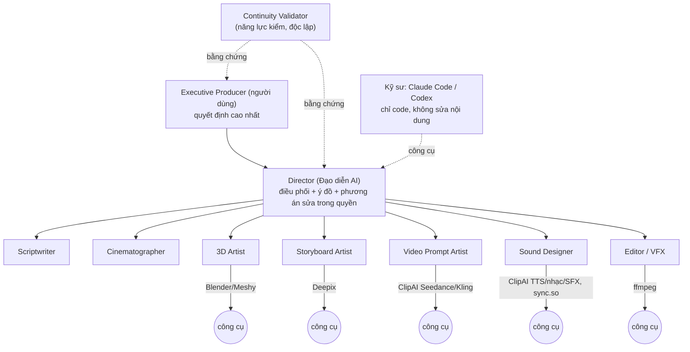

# M6 — AI Video Production Team (Tổ làm phim có chủ) — kế hoạch kiến trúc (21/10/2026)

> **Trạng thái:** kiến trúc ĐÃ CHỐT ĐỊNH HƯỚNG (Executive Producer, văn bản "PHÊ DUYỆT KIẾN TRÚC M6", chat 21/10) — **CHƯA PHÊ DUYỆT TRIỂN KHAI
> CODE**. Tài liệu Cấp 1 (0 USD). Sổ quyết định: `v31-m6-crew-architecture-2026-10-21`, `v31-m6-generation-limits-policy-b-2026-10-21`
> (thay bản đầu cùng ngày sau khi EP trả lời Q1/Q2/Q4). **EP trả lời 21/10:** Q1 không tính, Q2 có trừ, Q3 cần giải thích (mục 4d), Q4 có,
> Q5 chưa làm vội, Q6 sắp theo ưu tiên (mục 10a).
> Gộp vào `docs/KE_HOACH_V3_1_MASTER_BUILD_2026-10-20.md` mục 5 "M6". Đối chiếu: HEAD `main` = `e4693838`, `data/decisions.json` (42 mục),
> `CLAUDE.md`, Master Build V3.1. Bản đề xuất sáng 21/10 (8 ý) đã được thay bằng bản này — lịch sử ở git.
>
> **Được làm ngay (mục VIII văn bản phê duyệt):** audit repo, tài liệu kiến trúc, đối chiếu Master Plan, roadmap / dependency / nghiệm thu /
> test plan / rollback, ghi sổ quyết định. **Chưa được:** code pipeline M6, migration / sửa dữ liệu production, bật cờ mới trên máy chính,
> đổi provider / cấu hình job đang chạy, gọi API trả phí, tự gen lại trên production, xóa / ghi đè tài nguyên đã duyệt.

---

## 0. Bằng chứng audit (M6-P0 phần đã làm được ở Cấp 1, đo 21/10)

| # | Phát hiện | Số đo / nguồn | Hệ quả cho M6 |
|---|---|---|---|
| E1 | Phiên Claude Code đang sửa thẳng dữ liệu sản xuất | 376 lần sửa tay prompt (14/10, lẫn người + Claude); sao lưu `data/manifest.backup_20261018_truoc_sua_motion.sqlite`, `…_truoc_sua_shot_1_8_9_23`, `…_truoc_sua_15_18_33`, `…20261019_truoc_sua_motion_16_29_31` | Luật "Kỹ sư không sửa nội dung production" (I.3) cần check code (M6.0) |
| E2 | Lượt gen thực tế mỗi shot (job đã có mã provider) | #27: ảnh TB 5,0 / tối đa 11, **16/22 shot > 3**; video TB 4,4 / tối đa 12, **17/22 shot > 2** (kể cả nâng nháp → 1080p). #31: ảnh TB 2,6, 8/39 > 3; video TB 1,7, 8/39 > 2 | Trần mới (ảnh 3, video 2) sẽ đưa nhiều shot lên EP — xem câu hỏi Q1, Q2 mục 10 |
| E3 | Trần code hiện hành KHÁC chính sách mới | `core/pipeline.py:33` `AUTO_REGEN_LIMIT = {"image_gen": 3, "video_gen": 2}` = số lần TỰ gen LẠI (ảnh 1+3, video 1+2); `retry_count` chỉ đếm lượt máy tạo **từ thao tác gần nhất của người** (`_retries_exhausted`, đặt lại 0 khi người bấm); `quality_tier.RETRY_LIMIT = {"draft": 2, "final": 1}`; `autopilot._job_caps` = ảnh × 4 + video × 3; sổ D01b ghi "ảnh ≤ 3, video ≤ 2" | Chính sách mới = TỔNG lượt (ảnh 3 = 1 + 2, video 2 = 1 + 1), không đặt lại khi sửa prompt / đổi model / đổi người → Generation Authorization (M6.3) thay cách đếm; khi triển khai ghi D01c thay D01b |
| E4 | Lượt gọi Claude theo khâu | #31: `change_review` 648 lượt / 2,29 M token · `chat_prompt` 282 / 1,84 M · `video` 117 / 0,52 M · `director_plate_review` 90 · `director` 78 / 2,86 M · `set_analysis` 36 · … — **tổng ≈ 1 329 lượt / 39 shot**. #27: `change_review` 388, `video` 279, `trainee_qc_team` 228, `director` 72 | Nguồn giảm lớn nhất: rà soát tác động (≈ 17 lượt/shot) và D6 (≈ 7 lượt/shot) — mục 9 |
| E5 | Dashboard chậm — gốc chính đã tìm thấy | Đo trình duyệt: đổi bước 2,6–4,4 s, "✎ Sửa" 4,3–4,7 s, tab Motion #31 **36 s**. Đo máy chủ (CSDL chỉ đọc, cờ thật): `lineage.summary(#31)` **7,6–11,3 s**, 10 triệu lời gọi hàm: 5 016 lần `seedance_refs.shot_motion` (5,2 s), 158 089 `re.search` (2,4 s), `looks._gore_iter` 1,4 s. `core/memo.cached` chỉ nhớ TRONG một lần vẽ lại | Mỗi lần bấm tính lại dấu vân tay mọi shot. Sửa đúng gốc trước (M6.11), fragment / nạp lười sau |
| E6 | Module tái dùng đã có trên `main` | xem mục 1c | Không tạo module song song |
| E7 | M2 (BYĐ v2, write guard, field guard) chưa gộp `main` | nhánh `cloud/v31-m21`, `cloud/v31-m25` (guard shadow), `cloud/v31-m25b` (sửa tay motion → USER_LOCKED), tích hợp `cloud/v31-m2-tichhop`; chờ golden M1.9 (C-GOLDEN2) | M6 phần ghi dữ liệu phụ thuộc M2.1 / M2.5 (mục 7) |

---

## 1. Kiến trúc tổ làm phim và phân quyền

### 1a. Sơ đồ



### 1b. Quyền theo cấp (giữ nguyên quyền đã chốt; "Đội trưởng" → **Executive Producer** ở mọi tài liệu M6, Role Registry, Dashboard)

| Quyền | Executive Producer | Director | Vai chuyên trách | Continuity Validator | Kỹ sư |
|---|---|---|---|---|---|
| Đổi định hướng sáng tạo / ý đồ đã duyệt | ✔ | đề xuất | ✖ | ✖ | ✖ |
| Duyệt ngân sách, cấp thêm lượt gen | ✔ | ✖ | ✖ | ✖ | ✖ |
| Sửa dữ liệu / tài nguyên ĐÃ KHÓA (USER_LOCKED) | ✔ | ✖ (tạo REVIEW) | ✖ | ✖ | ✖ |
| Phân công, chọn phương án sửa trong quyền, xử lý xung đột vai | ✔ | ✔ | ✖ | ✖ | ✖ |
| Tự sửa + tự gen lại phần mình trong trần (mục 4) | ✔ | ✔ | ✔ | ✖ | ✖ |
| Tuyên bố "đạt" cho sản phẩm của mình | ✖ (duyệt) | ✖ | ✖ — cần bằng chứng độc lập (mục 5) | ghi bằng chứng | ✖ |
| Duyệt sản phẩm cuối | ✔ | đề xuất | ✖ | ✖ | ✖ |
| Sửa code, công cụ, ô sửa Dashboard | ✖ | ✖ | ✖ | ✖ | ✔ (Cấp 2) |

Không bắt buộc mỗi vai là một agent riêng: một vai = **trách nhiệm + quyền ghi + tiêu chí nghiệm thu + bộ công cụ**; phần việc tất định
do code của vai làm (0 USD), Claude chỉ gọi ở chỗ cần phán đoán.

### 1c. Vai ↔ module ĐÃ CÓ (tái dùng, không viết lại)

| Vai | Module / prompt hiện có | Thiếu |
|---|---|---|
| Executive Producer | `core/inbox.py` (📥 Cần bạn quyết), `release_gate.py` (M5.2), `auth`/`access` (Owner) | màn duyệt vượt quyền + cấp lượt |
| Director | `director_two_pass.py`, `prompts/19_director_intent.md`, `knowledge/roles/director.md`, `director_byd.py` + `shot_intent.py` (BYĐ; v2 ở `cloud/v31-m21`), `editor_review.py` (prompt 25), `prompt_rewrite.py` | điều phối phiếu, quyền duyệt clip trong trần |
| Scriptwriter | `idea_to_script.py`, `prompts/23_idea_to_script.md`, `knowledge/roles/screenwriter.md`, `dialogue.py` | — |
| Cinematographer | prompt 20 / 17 / 28, `knowledge/roles/dp.md`, `plate_camera.py`, `camera_plan.py`, `shots.py` | ô sửa `lens_mm`, `plate_view`, `start_frame` |
| 3D Artist | `stage_crew.py` (cờ, `decisions: stage-crew-plan-2026-10-16`), prompt 29b/29c/29d, `whitebox.py`, `plates3d.py`, `stage_facts.py`, `world_map.py` (M3.1), `meshy.py` | đứng tên lỗi nền, nhận phiếu |
| Storyboard Artist | `scene_storyboard.py`, `storyboard_frames.py`, `chat_prompt.py` (D6 ảnh), `image_models.py`, `asset_vision.py` | chưa có vai; `image_prompt` viết trước khi có plate |
| Video Prompt Artist | `chat_prompt.py` (D6 video), `knowledge/model_guides/{seedance,kling,image}.md`, `seedance_refs.py`, `motion_prompt_lint.py`, `video_pregen.py` | mục 3 |
| Sound Designer | `voice_casting.py`, `dialogue_take.py`, `music*.py`, `sfx_plan.py`, `ambience.py`, `lipsync.py`, `adapters/syncso.py` | sửa chữ đọc từng câu |
| Editor / VFX | `final_cut.py`, `ffmpeg_studio.py`, `music_cues.py`, `editor_review.py`, `skill_objects.py`, `end_popup.py`, `subtitles` | khâu ghép VFX + dựng kiểu #27 thành nút |
| Continuity Validator | `continuity_state.py` (M3.4), `continuity_shadow.py` (M4.3), `sequence_logic.py`, `continuity.py` (trục 180°), `camera_match_qc.py`, `framing_guard.py`, `clip_measure.py`, `qc_evidence.py` (M4.1) | gom thành một năng lực + ghi bằng chứng |
| Kỹ sư | `tools/hop_thu.py`, `devsys/errors.json`, quy ước 7 (`tools/related_areas.py`) | check "không ghi nội dung" |

---

## 2. Role Registry và Handoff Contract

### 2a. Role Registry — `data/crew_roles.json` (cấu hình trong git, cùng kiểu `data/decisions.json`; đọc bằng `core/crew.py`)

```json
{
  "version": 1,
  "roles": [{
    "id": "video_prompt_artist",
    "name": "Video Prompt Artist",
    "reports_to": "director",
    "reads":  ["scenes.data.byd", "scenes.data.end_state", "scenes.data.size|angle|move|lens_mm", "jobs:image_gen(approved)", "sent_package.refs", "provider_rules.video", "knowledge/model_guides/*"],
    "writes": ["motion_prompts.prompt", "motion_prompts.coverage"],
    "outputs": ["video_prompt"],
    "tools": ["claude:chat_prompt", "code:motion_prompt_lint", "code:video_pregen"],
    "acceptance": ["coverage_all_byd_beats", "lint_pass", "length_within_model_limit", "no_locked_field_changed"],
    "owns_errors": {"stages": ["L11", "L12"], "codes": ["motion_*", "prompt_*"]},
    "escalate": {"director": ["input_conflict", "intent_unclear", "attempts_exhausted"], "executive_producer": ["locked_change_needed"]},
    "claude_stage": "chat_prompt",
    "flag": "crew_vpa_shadow"
  }]
}
```

Trường bắt buộc mỗi vai: `id, name, reports_to, reads[], writes[], outputs[], tools[], acceptance[], owns_errors{stages, codes},
escalate{director|executive_producer: [lý do]}, claude_stage, flag`. `writes[]` là **danh sách trường duy nhất vai được ghi** — đưa vào write guard
M2.5 như "actor role" (không viết guard thứ hai). Bảng sở hữu trường (mỗi trường đúng MỘT vai chủ):

| Trường / sản phẩm | Vai chủ | Ghi chú |
|---|---|---|
| `scenes.text`, thoại, `delivery` (ý) | Scriptwriter | Director đề xuất sửa → REVIEW |
| `emotional_intent`, `beat`, `performance`, `byd` (ý đồ shot), `video_route`, chọn model trong danh sách được duyệt, duyệt clip trong trần | Director | BYĐ v2 (M2.1) là hợp đồng ý đồ |
| `size`, `angle`, `move`, `lens_mm`, `start_frame`/`blocking`, `plate_view`, `camera_setup`, `why` | Cinematographer | |
| sân khấu (`stage_crew`), `plate_spot`, render plate, `world_map` cảnh | 3D Artist | world map không bắt buộc (D06) |
| `image_prompt`, chọn ảnh ref gửi kèm, job ảnh | Storyboard Artist | |
| `motion_prompts.prompt` | Video Prompt Artist | `end_state` thuộc Director (BYĐ), VPA chỉ đọc |
| giọng, chữ đọc, nhạc, `sfx_plan`, khớp môi | Sound Designer | |
| bản dựng, chuyển cảnh, chữ, popup, VFX ghép | Editor / VFX | |
| `continuity_state.observed`, bằng chứng QC | Continuity Validator | chỉ ghi bằng chứng, không sửa sản phẩm |

### 2b. Handoff Contract — một bản ghi mỗi lần bàn giao

```json
{
  "handoff_id": "uuid", "project_id": 31, "scene_id": 1204, "shot_no": 17,
  "from_role": "storyboard_artist", "to_role": "video_prompt_artist",
  "artifact": {"kind": "image", "job_id": 911, "rel_path": "data/projects/31/images/17_911.png", "sha256": "…"},
  "revision": {"scene_rev": 12, "byd_v": 2, "fields": {"image_prompt": 5}},
  "depends_on": [{"kind": "plate", "rel_path": "…", "sha256": "…"}, {"kind": "byd", "rev": 4}, {"kind": "kho_form", "asset_id": 1149}],
  "qc_evidence": ["qc_run:…"], "status": "proposed|accepted|returned|approved_by_director|approved_by_ep",
  "attempts": {"image": "2/3", "video": "0/2"}, "cost_usd_est": 0.12,
  "actor": {"role": "storyboard_artist", "provider": "claude_cli", "model": "…", "code_sha": "…"},
  "note": "", "created_at": "…"
}
```

Lưu ở đâu (không nguồn song song): **shadow trước** — `<data>/<pid>/crew/handoffs.jsonl` (giống cách `qc_evidence` ghi tạm `qc_shadow/*.jsonl`);
khi duyệt Cấp 3 mới migration bảng `handoffs`. Revision lấy từ cơ chế revision của write guard M2.5 (không tự đếm riêng); `depends_on` dùng cùng
khóa của `core/lineage.py` (input_hash) + `sent_package.rel_path/sha` → "stale" chỉ đánh dấu sản phẩm phụ thuộc thật (V).

---

## 3. Video Prompt Artist (VPA)

**Vị trí:** vai chuyên trách dưới Director. Director quyết ý đồ (BYĐ v2); VPA quyết cách diễn đạt prompt cho đúng model.

**Đầu vào (đọc, không ghi):** BYĐ v2 (`shot_intent.read`, có provenance), ảnh khung đầu đã duyệt (+ khung cuối nếu có), danh sách ảnh/video tham
chiếu ĐÚNG như gói sẽ gửi (`VideoRunner._build_package` — một builder dùng chung, M1.9/WS4 4.1), camera của Cinematographer, ràng buộc model
(`data/provider_rules.json`, `video_rules.prompt_limit`), hướng dẫn một trang theo model (`knowledge/model_guides/*.md`), dữ kiện code biết
(plate, tên Kho, cỡ vật mốc, hướng).

**Đầu ra:** `prompt` + `coverage[]` (mỗi nhịp BYĐ ↔ cụm chữ diễn đạt nó) + `model_target` + `refs_order` + `fingerprint` (đầu vào).

**Luồng:**
1. Code dựng đề bài từ dữ kiện (0 USD) → kiểm mâu thuẫn TRƯỚC (BYĐ ↔ ảnh ↔ camera; vd. "đứng" mà ảnh quỳ, máy trước mặt mà nền `away`) → có
   mâu thuẫn: **trả phiếu về vai chủ dữ liệu** (Director / Cinematographer / Storyboard), không gọi Claude.
2. Một lượt Claude (engine `core/chat_prompt.py`, nhìn ảnh) viết prompt liền mạch theo thứ tự ưu tiên của tổ.
3. Code chỉ KIỂM (`motion_prompt_lint`, `speaker_lint`, giới hạn ký tự, mã ảnh "Image N", từ cấm) → sai: trả VPA kèm phát hiện (tối đa 1 lần
   viết lại), không tự sửa.
4. Prompt USER_LOCKED (M2.5 + `cloud/v31-m25b`): VPA không viết đè; chỉ tạo đề xuất diff ở trạng thái REVIEW_REQUIRED.

**Nguyên tắc code không sửa nội dung (II.5):** các lớp hiện đang ĐỔI CHỮ âm thầm phải chuyển thành *phát hiện trả VPA* khi vai bật:
`skill_objects.standing_text` (thay "rise/grow" → "already standing"), `chat_prompt` đổi "clock tower" → "stone tower" (diag
`chat_prompt_feature_word`), các câu nối của `prompt_formula` / START LOCK / câu cấm dấu "+". Khi cờ vai TẮT → giữ nguyên hành vi cũ (byte giống).

**Shadow Mode (II.6):** cờ `crew_vpa_shadow` — mỗi lần gửi video, VPA viết prompt song song, KHÔNG gửi; lưu cặp (cũ, VPA) + coverage vào
`<pid>/crew/vpa_shadow.jsonl`. So sánh: (a) golden replay M1.9 (0 USD, mọi shot #24/#27/#31), (b) EP so mù trên Dashboard (0 USD), (c) chỉ
khi EP duyệt chi phí: pilot gen thật. **Chuyển mặc định khi:** coverage 100 % nhịp BYĐ, 0 vi phạm trường khóa, lint đạt ≥ 98 %, EP chọn bản VPA
≥ 2/3 ca so mù trên ≥ 15 shot, số lượt Claude ≤ 1,5/shot.

**Storyboard Artist** dùng cùng khuôn (engine D6 ảnh, nhìn plate + Kho, `coverage` theo BYĐ + Kho), shadow `crew_sba_shadow`, cùng tiêu chí.

---

## 4. Generation Authorization và Repair Budget

### 4a. Chính sách (đã chốt, III)
Mỗi shot / một chu kỳ sản xuất được duyệt: **ảnh ≤ 3 lượt** (1 + 2 gen lại), **video ≤ 2 lượt** (1 + 1). Tính chung mọi vai, model, worker,
đường gọi. Không đặt lại khi sửa prompt, đổi model, khởi động lại worker, đổi người. Lượt provider đã nhận = tính, tới khi có bằng chứng
không phát sinh generation. Hết lượt / ngân sách / cần đổi ý đồ → chuyển EP. **Đây là chính sách, chưa phải lệnh bật tự gen trả phí.**

### 4b. Một cổng dùng chung — `core/gen_auth.py`

```python
@dataclass
class Decision:
    allow: bool
    code: str            # OK | ATTEMPTS_EXHAUSTED | BUDGET_EXCEEDED | LOCKED_CHANGE | DUPLICATE_INFLIGHT | PROVIDER_UNVERIFIED
                         # | MODEL_NOT_APPROVED | NO_CAUSE | PAUSED
    attempts_used: int; attempts_limit: int
    budget_left_usd: Optional[float]
    needs_ep: bool; reason_vi: str

def authorize(conn, *, project_id, scene_id, kind, model, actor_role, cause_code, input_fingerprint, est_usd) -> Decision
def record_outcome(conn, job_id, outcome)   # accepted | rejected_before_generation (có bằng chứng) | unknown
```

- **Một chỗ gọi:** ngay trước `provider.submit` trong `runner._submit_pending` — cùng chỗ đã có `send_claim` (M1 1.1), `pause_before_submit`
  (M1.3) — và cả đường thử lại / lùi model (`seedance_refs.next_route`). Các nút tạo job không cần sửa từng nút: job bị giữ ở cổng.
- **Đếm (Q1: bước nâng 1080p của nháp đã duyệt không tính):** job cùng `(scene_id, kind, cycle_id)` đã có `external_id` HOẶC `poll_claim.unknown_outcome` → tính; job `RESEND_NOTE` /
  `runner._not_created` (có bằng chứng provider không tạo) → không tính. Bỏ phụ thuộc `retry_count` (đặt lại khi người bấm).
- **Chu kỳ (`cycle_id`):** tăng chỉ khi EP duyệt đổi ý đồ / cấp lượt mới (ghi kèm lý do, người duyệt, thời điểm — sổ cấp lượt shadow
  `<pid>/crew/grants.jsonl`, bảng = Cấp 3).
- **Điều kiện tự sửa (III 1–6):** đủ lượt; trong ngân sách EP duyệt cho tự sửa (dùng `spend_gate.assess` + `cost.estimate`); không đụng trường
  khóa (write guard M2.5); `cause_code` thuộc `devsys/errors.json`/`qc_evidence.CODES` + phương án từ `repair_router.plan` (M5.1); không có
  job cùng shot đang chạy (`send_claim`) và provider đã xác minh (`poll_claim`); model trong danh sách dự án được duyệt (`model_router`).
- **Repair Budget** = (lượt còn theo shot) + (USD tự sửa còn lại của dự án, EP đặt) + (lượt Claude theo vai, mục 9). Hiện trên thẻ shot.
- **Giữ D01b cho thao tác của EP:** ngân sách dự kiến vẫn chỉ CẢNH BÁO khi EP tự bấm (chính sách 04/10); cổng chỉ CHẶN hành động TỰ ĐỘNG của vai.

### 4c. EP đã chốt (21/10)
- **Q1 — nâng nháp 480p → 1080p KHÔNG tính lượt.** Lượt video chỉ đếm lần gen ra nội dung mới (nháp hoặc gen thẳng); bước nâng bản cao cùng
  bố cục / chuyển động của nháp đã duyệt không trừ. Cổng vẫn kiểm các điều kiện khác (không trùng job, ngân sách, provider đã xác minh).
- **Q2 — EP tự bấm "Vẽ lại / Gen lại" CÓ trừ lượt.** Hết lượt thì nút hỏi EP xác nhận vượt + lý do (EP là người có quyền cấp thêm) — ghi vào
  sổ cấp lượt; số đã dùng không đặt lại.
- **Q4 — thang lùi model tự động CÓ** (vd. Seedance 2.5 bị từ chối → Kling) khi model đích nằm trong danh sách model đã duyệt của dự án; lượt
  bị từ chối có bằng chứng "không phát sinh generation" thì không tính, lượt đã sinh thì tính; lùi model KHÔNG đặt lại số lượt.
- **Q3 — ngân sách tự sửa:** chờ EP chọn sau phần giải thích ở 4d.

### 4d. Q3 giải thích — "ngân sách cho tự sửa" là gì và nên đặt thế nào
**Là gì:** số tiền tối đa các VAI được TỰ chi cho việc làm lại (gen lại ảnh / video sau lượt đầu) trong một dự án mà không hỏi EP. Không gồm:
lượt đầu của mỗi shot (đã có dự toán dự án), bước nâng 1080p (Q1), thao tác EP tự bấm (vẫn theo D01b: chỉ cảnh báo), Claude chạy bằng gói
`claude_cli` (đo bằng số lượt — mục 9). Chạm ngân sách → vai dừng tự sửa, phiếu lên EP (không chặn EP).

**Số thật (sổ chi, chỉ đọc 21/10):**

| Dự án | Lượt đầu (ảnh + video) | Làm lại đã chi | Làm lại NẾU áp trần mới (ảnh 1+2, video 1+1) | Làm lại theo trần mới / lượt đầu |
|---|---|---|---|---|
| #27 | 1,14 + 62,98 = 64,12 USD | 4,68 + 35,44 = 40,12 USD | 1,98 + 21,44 = 23,42 USD | **37 %** |
| #31 | 2,29 + 23,79 = 26,08 USD | 3,22 + 10,81 = 14,03 USD | 2,08 + 5,52 = 7,60 USD | **29 %** |

Trường hợp xấu nhất theo trần mới (mọi shot dùng hết lượt) = 2 × tiền ảnh lượt đầu + 1 × tiền video lượt đầu ≈ **100 %** tiền lượt đầu (video
chiếm phần lớn): trần lượt đã tự giới hạn tiền, nhưng mức xấu nhất gấp ~3 lần thực tế.

**Ba cách đặt:**

| Cách | Làm thế nào | Ưu | Nhược |
|---|---|---|---|
| A. Số USD cố định / dự án | EP gõ một số (vd. 15 USD) | đơn giản | dự án 10 shot và 40 shot dùng chung một số — dự án lớn hết sớm, dự án nhỏ thừa |
| **B. % tiền lượt đầu (đề xuất)** | code lấy dự toán lượt đầu (`cost.estimate_*`, đã có trong `project_budget.propose`) × % EP chọn; mặc định **40 %** | tự co giãn theo số shot / model / độ dài; 40 % phủ cả #27 (37 %) và #31 (29 %) | dự toán sai thì ngân sách sai theo (dự toán đang được sửa ở M1.6) |
| C. Không đặt riêng | chỉ dùng trần lượt / shot | không thêm khái niệm | mức xấu nhất ≈ 100 % lượt đầu, không có điểm dừng sớm khi nhiều shot cùng hỏng (vd. lỗi hệ thống làm mọi clip lệch) |

**Đề xuất:** B, mặc định 40 %, EP đổi được theo dự án. Dashboard hiện cạnh nhau: dự toán lượt đầu, ngân sách tự sửa, đã dùng, mức xấu nhất theo
trần lượt (tham khảo). Thêm chốt an toàn: một vai tự sửa hỏng liên tiếp ≥ 3 shot cùng mã lỗi → dừng tự sửa, phiếu lên Director / Kỹ sư (dấu
hiệu lỗi hệ thống, không phải lỗi từng shot).

---

## 5. QC, định tuyến lỗi và continuity

- **QC độc lập (IV):** vai tạo sản phẩm được tự kiểm sơ bộ, nhưng trạng thái "đạt" chỉ hợp lệ khi có bản ghi `qc_evidence` từ người kiểm
  KHÁC vai tạo: số đo code (`clip_measure`, `framing_guard`, `camera_match_qc`, `final_qc`, `plate_layout_qc`), Continuity Validator, Director
  (với sản phẩm của vai dưới), hoặc EP. Giữ D07 (shadow → guarded; mã từ VLM không BLOCK) và `qc-team-off-2026-10-14`.
- **Định tuyến:** phát hiện → mã (`qc_evidence.CODES` ↔ `devsys/errors.json` `stage` L1–L16) → vai chủ theo `crew_roles.owns_errors` →
  phiếu (handoff `status=returned`). Lỗi hệ thống / API / code → `tools/hop_thu.py` cho Kỹ sư, không cho vai sáng tạo.
- **Leo thang:** vai sửa ≤ số lượt còn → Director (đổi phương án: model khác trong danh sách, ghép code qua Editor/VFX, đổi cách quay) → EP
  (vượt lượt / ngân sách / đổi ý đồ / dữ liệu khóa).
- **Continuity (V):** dùng chung BYĐ v2, Kho (D05), `world_map` (D06, không bắt buộc), `continuity_state` expected/observed/resolved (M3.4),
  `continuity_shadow` (M4.3), `sequence_logic`. Continuity Validator là một **năng lực** (code trước, Claude chỉ khi mơ hồ), chạy khi có
  handoff ảnh/clip mới, ghi `observed` + bằng chứng; không tạo kho dữ liệu riêng.

---

## 6. Dashboard và tốc độ

### 6a. Màn cho Executive Producer (theo VI)
| Cần | Dựng trên cái đã có | Mới |
|---|---|---|
| Xem / sửa theo vai | trình sửa cảnh Bước 1, thẻ ảnh / clip | nhóm ô theo vai chủ (mục 2a), khóa ô không thuộc quyền vai đang xem |
| Yêu cầu sửa bằng ngôn ngữ tự nhiên | ô "Mô tả điều muốn đổi" (D6, Bước 2/4) | MỘT ô cho mọi shot/khâu → Director phân vai |
| Phiếu lỗi, vai chịu trách nhiệm, tiến độ | 📥 inbox, trang sổ lỗi devsys | bảng phiếu theo vai / shot |
| Prompt, reference, payload thật | `send_preview_ui`, thẻ gói gửi M4.7 (XEM), `sent_package` | — |
| So sánh trước / sau | `prompt_versions_ui`, `older_take_ui` | diff theo revision |
| Lượt gen + ngân sách còn | `money_policy`, `limits_ui` | bộ đếm `gen_auth` trên thẻ shot |
| Duyệt vượt quyền | 📥 "Cần bạn quyết" | nút cấp lượt / duyệt đổi ý đồ |
| Duyệt sản phẩm cuối | `release_gate` (M5.2), Bước 5 | — |

Thiếu ô sửa (rà 21/10): BYĐ (chỉ xem), `lens_mm` / `plate_view` / `start_frame` / `lip_sync` (không có ô), chỗ đứng / máy / vật mốc 3D
(M4.8b), chọn bỏ từng ảnh tham chiếu, sửa chữ đọc TTS từng câu, VFX ghép, dựng kiểu #27; "Câu sửa (tiếng Anh)" ở Bước 2/4 → thay bằng mô tả.

### 6b. Tốc độ — theo profiling (VI: không chỉ đổi giao diện)
1. **Gốc E5:** `lineage.scan` tính lại hash ảnh/motion/video của mọi shot mỗi lần vẽ lại (`memo` chỉ trong một lần). Sửa: nhớ kết quả theo
   (`PRAGMA data_version`, dấu `change_events` mới nhất của dự án) GIỮA các lần vẽ lại; hash từng shot nhớ theo `scenes.data` sha — chỉ tính lại shot
   đổi. Mục tiêu `lineage.summary(#31)` < 0,3 s.
2. Đo đủ phía máy chủ: bộ hẹn giờ từng khối (header, thanh bước, thẻ, đọc CSDL) → diag khi > 1 s; chạy trên bản sao an toàn (memory
   `reference_safe_copy_testing`).
3. Thẻ shot = `st.fragment`; trình sửa trong `st.dialog`; tab Motion/Video nạp lười media, phân trang ≥ 12 shot.
4. **Chỉ số chính:** *thời gian tới một shot đạt chuẩn* (từ lúc EP yêu cầu tới lúc shot được duyệt: `job_events` + nhật ký thao tác `ui_log`),
   phụ: mở shot ≤ 1 s, đổi bước ≤ 2 s, tab Motion #31 ≤ 3 s (đo lại đúng cách bảng E5).

---

## 7. Ma trận phụ thuộc M1–M6

| Việc M6 | Cần (phải đạt nghiệm thu trước) | Có thể làm song song với |
|---|---|---|
| M6.0 audit + sổ + check "Kỹ sư không ghi nội dung" | — | mọi việc |
| M6.1 Role Registry + `core/crew.py` (đọc) | — | M2 |
| M6.2 Handoff Contract shadow | M1.9 golden (đường gói chung), M2.6 `sent_package` rel_path | M2.1 |
| M6.3 Generation Authorization (shadow → chặn tự động) | M1.2 poll nguyên tử, M1.3 pause-before-submit, M1.5, M1.6 giá đúng, M5.1 repair router | M2 |
| M6.4 Write guard theo vai | **M2.5 write guard** + M2.5b field guard (đang ở nhánh) | — |
| M6.5 Video Prompt Artist shadow | **M2.1 BYĐ v2**, M1.9 replay video, M2.8 router/ngân sách ký tự | M6.6 |
| M6.6 Storyboard Artist shadow | M2.1, M2.7 image preflight, M3.3 câu vị trí | M6.5 |
| M6.7 3D Artist | M3.1–M3.3, M4.8 bàn đạo diễn 3D | M6.8 |
| M6.8 Sound Designer + Editor/VFX | M2.9 lời dẫn ngoài khớp môi, M4.4 final QC | M6.7 |
| M6.9 Continuity Validator | M3.4, M4.1 qc_evidence, M4.3 | M6.7 |
| M6.10 Dashboard điều phối | M4.7 (thẻ gói, overrides C3-4), M6.1–M6.3 | M6.11 |
| M6.11 Tốc độ Dashboard | — (bắt đầu ngay khi được duyệt code) | mọi việc |
| M6.12 Replay offline + pilot | M5.3 vòng A, M6.3 + M6.5 + M6.6 shadow đủ dữ liệu | — |

---

## 8. Schema / interface, test, nghiệm thu, rollback

| Việc | Interface / schema | Test bắt buộc | Nghiệm thu | Rollback |
|---|---|---|---|---|
| M6.1 | `data/crew_roles.json` + `core/crew.py` (`roles()`, `owner_of(field)`, `can_write(role, field)`, `problems()`) | mỗi trường đúng 1 vai chủ; `writes` ⊂ trường thật; `owns_errors.stages` ⊂ `devsys/stages.json`; `claude_stage` ⊂ stage sổ chi | `py -m core.crew check` = 0 lỗi | chỉ đọc — xóa file = như cũ |
| M6.2 | `core/handoff.py` `record(...)`, `latest(scene, role)`; jsonl shadow | trường đủ; revision/sha khớp lineage; cờ TẮT = 0 ghi | 1 dự án replay đủ chuỗi bàn giao | cờ `crew_handoff_shadow` TẮT |
| M6.3 | `core/gen_auth.py` (mục 4b) | 6 điều kiện III từng ca; không đặt lại khi sửa prompt/đổi model/restart; unknown_outcome tính lượt; RESEND_NOTE không tính; giữ D01b cho thao tác EP | shadow trên replay #27/#31: số shot cần EP khớp tính tay (E2) | cờ `gen_auth` = shadow (chỉ ghi) → TẮT |
| M6.4 | actor = role trong guard M2.5 | vai ghi trường không thuộc quyền → REVIEW (shadow) | 0 ghi sai quyền trên replay | cờ guard theo vai TẮT |
| M6.5/6.6 | `chat_prompt` + `coverage`; jsonl shadow | coverage; trường khóa không đổi; không câu nào do code chèn; trả phiếu khi mâu thuẫn | tiêu chí mục 3 | cờ `crew_vpa_shadow` / `crew_sba_shadow` TẮT |
| M6.11 | cache lineage giữa lần vẽ lại | kết quả `lineage.summary` byte giống trước/sau trên 3 dự án; đổi 1 shot → chỉ shot đó tính lại | số đo E5 đạt mục tiêu | cờ `lineage_cache` TẮT |

Chung: mọi cờ mới mặc định TẮT, `verified: False`; golden M1.9 byte giống khi TẮT; quy ước 7 (agent rà khu vực liên quan) trước mỗi commit
code; thêm cờ verified False → thêm vào `tests/golden/package_inputs.json` (luật 21/10).

---

## 9. Chi phí vận hành và giảm lượt gọi Claude

**Hiện trạng (E4):** #31 ≈ 1 329 lượt Claude / 39 shot (≈ 34 lượt/shot): rà soát tác động 49 %, D6 21 %, QC video 9 %, Đạo diễn 6 % lượt
nhưng nhiều token nhất (2,86 M). Với `claude_cli` (D02) lượt tính vào hạn mức gói, sổ chi vẫn ghi USD quy đổi.

| Cách giảm | Áp vào | Ước giảm |
|---|---|---|
| Rà soát tác động chỉ chạy khi có handoff / trường ngữ nghĩa đổi, gom theo cảnh, bỏ trường sổ sách | `change_review` (648 lượt) | −60 → −75 % |
| VPA/SBA: một lượt / shot / fingerprint đầu vào; xem trước dùng kết quả nhớ (`chat_prompt.fingerprint` đã có) | `chat_prompt` (282) | ≈ 7 → ≤ 1,5 lượt/shot |
| Code kiểm trước, Claude chỉ khi mơ hồ (mâu thuẫn BYĐ↔ảnh, continuity) | VPA, Continuity Validator | tránh lượt "viết rồi bị code chặn" (2/5 ở thử D6 14/10) |
| Director: phần chung trước dấu cache (đã có ở hai lượt) + chỉ hỏi lại cảnh lỗi | `director` | giữ, đo token |
| Không gọi Claude cho phiếu có phương án tất định (`repair_router` mã → cách sửa) | vòng sửa | — |
| **Mục tiêu** | dự án ~40 shot | **≤ 600 lượt (≈ 15/shot)**, đo bằng sổ chi theo `stage` |

Chi phí gen (ảnh/video/âm) không đổi theo vai; trần lượt mới giới hạn trường hợp xấu nhất mỗi shot = 3 ảnh + 2 video (giá theo
`cost.estimate` + `pregen_check` — không tính tay).

---

## 10. Lộ trình, pilot và điểm EP phê duyệt

| Pha (VII) | Việc | Cấp | Điểm EP duyệt |
|---|---|---|---|
| **M6-P0** Audit | M6.0: phần đã làm ở mục 0; còn: audit mọi caller tạo job + đường ghi theo vai (đối chiếu `V3_1_M0_10_BAO_VE_DU_LIEU`), profiling máy chủ đủ khối | 1 | — |
| **M6-P1** Registry + hợp đồng + cổng | M6.1, M6.2, M6.3 (shadow) | 2 | gói phạm vi Cấp 2 M6-P1 |
| **M6-P2** Nền M1/M2 | M6.4 sau khi M2.1/M2.5 gộp; golden đạt | 2 | cùng gói M2 |
| **M6-P3** VPA + SBA shadow | M6.5, M6.6 | 2 | so mù 0 USD; pilot gen thật = Cấp 3 |
| **M6-P4** Vai còn lại | M6.7, M6.8, M6.9 | 2 | — |
| **M6-P5** Dashboard + tốc độ | M6.10, M6.11 (M6.11 xin làm sớm — không phụ thuộc) | 2 | — |
| **M6-P6** Replay + pilot | M6.12: replay #24/#27/#31 offline (0 USD) → pilot B 5–8 shot (M5.4) → C | 3 | dự toán + đồng ý chi |

**Không tự bật** vai có quyền ghi production hoặc gọi API trả phí khi phụ thuộc chưa đạt nghiệm thu (VII).

### 10a. Thứ tự ưu tiên (EP Q6, 21/10) — theo giá trị + phụ thuộc đã đạt
Q5: M6.11 (tốc độ) **chưa làm** — chờ các việc theo kế hoạch V3.1 (M1–M5) hoàn thành rồi mới làm; số đo E5 giữ làm mốc.

| Ưu tiên | Việc | Vì sao đứng đây | Phụ thuộc hiện nay | Gói duyệt |
|---|---|---|---|---|
| 1 | **M6.0** hoàn tất audit (caller tạo job, đường ghi theo vai) | nền cho mọi gói | không | làm ngay (Cấp 1) |
| 2 | **M6.1** Role Registry (chỉ đọc) | mọi vai / cổng / Dashboard đọc nó | không | **Gói M6-A** (Cấp 2) |
| 3 | **M6.3** Generation Authorization — shadow | giữ tiền: chặn gen thừa (E2); không phụ thuộc M2 | M1.2/M1.3/M1.5/M1.6 ✅, M5.1 ✅; chờ EP chốt Q3 | **Gói M6-A** |
| 4 | **M6.9** Continuity Validator — shadow | QC độc lập là điều kiện "đạt" của mọi vai | M3.4 ✅, M4.1 ✅, M4.3 ✅ | **Gói M6-A** |
| 5 | **M6.5** Video Prompt Artist — shadow | chất lượng video lớn nhất (prompt ghép); D6 đã có | **M2.1** + golden M1.9 | **Gói M6-B** (sau golden + gộp M2) |
| 6 | **M6.2** Handoff Contract — shadow | truy vết bàn giao, stale đúng phụ thuộc | M1.9, M2.6 | Gói M6-B |
| 7 | **M6.4** Write guard theo vai | vai không ghi đè nhau / dữ liệu khóa | M2.5 (+ M2.5b) | Gói M6-B |
| 8 | **M6.6** Storyboard Artist — shadow | ảnh khung đầu bám plate + Kho | M2.1, M2.7 | Gói M6-B |
| 9 | **M6.10** Dashboard điều phối EP | dùng được khi đã có registry, cổng, phiếu | M4.7, M6.1–M6.3 | **Gói M6-C** |
| 10 | **M6.8** Sound Designer + Editor/VFX | đưa dựng / VFX kiểu #27 thành khâu | M2.9, M4.4 | Gói M6-C |
| 11 | **M6.7** 3D Artist | sau bàn đạo diễn 3D | M3.1–M3.3, **M4.8** | Gói M6-C |
| 12 | **M6.11** Tốc độ Dashboard | EP Q5: chờ kế hoạch khác xong | M1–M5 xong | gói riêng sau |
| 13 | **M6.12** Replay offline + pilot | nghiệm thu thực tế | M5.3, M6.3, M6.5, M6.6 | Cấp 3 (dự toán) |

**Trình duyệt:** Gói M6-A (M6.1 + M6.3 shadow + M6.9 shadow, 0 USD, cờ TẮT) trình khi EP chốt Q3; Gói M6-B khi golden M1.9 đạt và M2 gộp
`main`; Gói M6-C sau M6-B.

### Câu hỏi còn mở cho Executive Producer
- **Q3.** Chọn cách đặt ngân sách tự sửa (mục 4d): A số USD cố định / **B % tiền lượt đầu, mặc định 40 % (đề xuất)** / C không đặt riêng.
