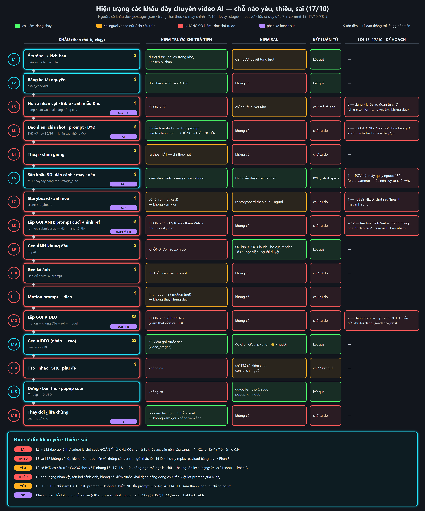
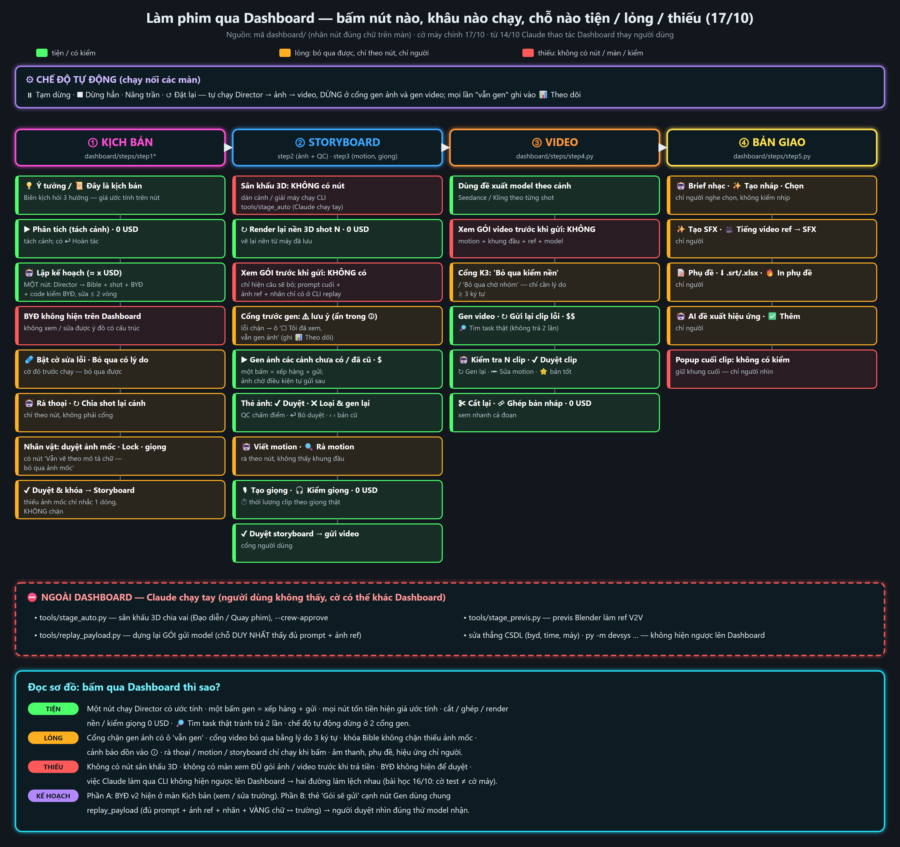
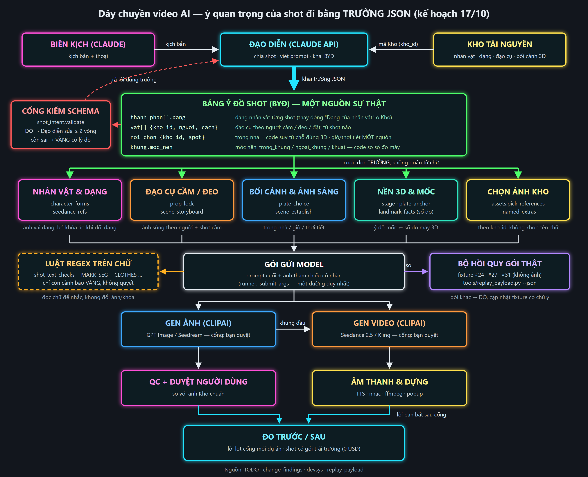

# Kế hoạch: ý shot thành trường có cấu trúc + bộ hồi quy trên gói gửi thật (17/10)

> Trạng thái: **CHỜ NGƯỜI DÙNG DUYỆT**. Chỉ là tài liệu, chưa sửa code. Không gen, không gọi API tốn tiền.
> Lập theo skill `vong-lam-viec-theo-plan` mục 4b. Một phiên khác đang làm gốc (1) "một sự thật lưu nhiều chỗ" và (2) "bộ kiểm rời rạc"
> cho 3 lỗi cụ thể. Kế hoạch này lo gốc (3) "luật so chữ trên prompt tự do" và (4) "test theo dữ liệu giả".

## 0. Ba sơ đồ (đọc trước)
Ba sơ đồ nằm ở `docs/so_do/` (PNG để xem, SVG gốc cạnh bên). Hai sơ đồ đầu sinh bằng `py docs/so_do/gen_hien_trang_khau.py <out.svg>` và
`py docs/so_do/gen_dashboard.py <out.svg>`; dữ liệu ghi ngay trong script.

**Sơ đồ 1 — Hiện trạng 16 khâu: chỗ yếu, thiếu, sai.** Mỗi khâu (L1…L16 theo sổ khâu `devsys/stages.json`) là một hàng, gồm: kiểm
trước khi trả tiền, kiểm sau, kết luận từ đâu, lỗi 15–17/10. Trạng thái lấy từ `devsys.stages.effective` với **cờ máy chính** 17/10,
không lấy cờ mặc định.

Đọc sơ đồ 1:
- **SAI:** L8 + L12 (lắp gói ảnh / video) là chỗ code đoán ý từ chữ. Khoảng 14/22 lỗi 15–17/10 nằm ở đây.
- **THIẾU:** L8 và L12 không có lớp kiểm nào trước khi trả tiền, cũng không có test trên gói thật → phần B.
- **YẾU:** BYĐ ở L3 có cấu trúc nhưng L5, L7, L8, L12 không đọc → phần A.
- **THIẾU:** L5 Kho không có kiểm trước (dạng khai bằng chữ, tên Việt lọt vào prompt).
- **YẾU:** L3, L10, L11 chỉ kiểm cấu trúc, không kiểm nghĩa. L4, L14, L15 chỉ có người kiểm.

**Sơ đồ 2 — Làm phim qua Dashboard: bấm nút nào, khâu nào chạy, chỗ nào tiện / lỏng / thiếu.** Nhãn nút ghi đúng chữ trên màn
(`dashboard/steps/step1*…step5.py`).

Đọc sơ đồ 2:
- **Tiện:**
  - một nút "🤖 Lập kế hoạch" chạy Director (có ước tính);
  - "▶ Gen ảnh…" một lần bấm vừa xếp hàng vừa gửi;
  - mọi nút tốn tiền hiện giá ước tính;
  - cắt, ghép, render nền, kiểm giọng đều 0 USD;
  - "🔎 Tìm task thật" tránh trả tiền 2 lần.
- **Lỏng:**
  - cổng chặn gen ảnh có ô "☐ Tôi đã xem, vẫn gen ảnh";
  - cổng video bỏ qua được chỉ với lý do ≥ 3 ký tự;
  - "✔ Duyệt & khóa → Storyboard" không chặn khi thiếu ảnh mốc;
  - cảnh báo dồn vào ⓘ;
  - rà thoại / motion / storyboard chỉ chạy khi bấm.
- **Thiếu:**
  - không có nút sân khấu 3D (chạy CLI `tools/stage_auto.py`);
  - **không có màn xem đủ gói sẽ gửi** (chỉ hiện câu sẽ bỏ);
  - BYĐ không hiện ở đâu trên Dashboard;
  - việc làm qua CLI / sửa thẳng CSDL không hiện ngược lên Dashboard.

  Đây đúng là đường lệch "cờ test ≠ cờ máy" của 16/10. Hai việc thêm ở A5 và B4 lấp chỗ này.

**Sơ đồ 3 — Luồng sau khi đổi (đích của kế hoạch).** Đạo diễn khai bảng ý đồ shot (BYĐ). Code kiểm schema, rồi 5 khâu đọc
**trường** để dựng gói. Luật regex chỉ còn nhắc VÀNG. Bộ hồi quy so gói thật của #24/#27/#31. Lỗi lọt cổng được đếm trước và sau.

---

## 1. Vì sao

### 1.1 Triệu chứng
Có 6057 test xanh mà #31 vẫn lọt nhiều lỗi. Mỗi bản vá luật chữ lại sinh ra ca biên mới. Riêng 15–17/10, các mục rà quy ước 7 và các
commit `b193fee9..40ff268a` có **khoảng 20 lỗi** mà gốc là **code đoán ý từ chữ tự do** (bảng 1.3). Ba ngày qua, việc sửa các lỗi này
tốn 2 nhánh agent, 2 lượt rà và 2 vòng sửa (`c9408830`, `666e99bb`, `40ff268a`). Vòng sửa sau lại tìm ra lỗi do chính vòng trước gây ra:
- lần 1 tách mệnh đề theo dấu phẩy → mất "never";
- lần 2 lại phải sửa để "never" áp lên mọi câu;
- regex `_POST_ONLY` có ký tự backspace thay cho `\b`, nên "overlay" chưa bao giờ khớp. Lỗi này không test nào bắt được, vì test viết
  theo giả thuyết của chính người viết regex.

### 1.2 Phát hiện chính khi đọc dữ liệu thật (0 USD, CSDL chỉ đọc)
**Trường có cấu trúc đã có sẵn nhưng các khâu sau không đọc.**
- `core/shot_intent.py` (BYĐ, K0a/K1a, kế hoạch `KE_HOACH_KIEM_SOAT_NHAT_QUAN_2026-10-10.md`) đã có `thanh_phan[].dang`,
  `noi_chon.{kho_id, spot, thoi_gian, thoi_tiet}` và `vat`. Cờ `shot_intent` **đang BẬT** ở máy chính (`data/feature_settings.json`).
- #31: **36/36 shot có `byd`**, `byd_kiem` = ok cả 36. **24 shot khai `dang`** (vd shot 2: Kelly `dang: "bong_mo"`). #24: 12/12 shot có BYĐ,
  8 shot khai dạng. #27: 0 (làm trước K1a).
- Nhưng G2 (17/10) lại dựng thêm một nguồn dạng thứ hai: `core/character_forms.py` đọc dòng chữ "Dạng của nhân vật: KELLY" trong mô tả
  Kho phong cách, rồi khớp tên phong cách trong chữ shot. Nguồn này cho **21/36 shot**, còn BYĐ cho **24/36**. Hai nguồn lệch nhau
  khoảng 3 shot (đếm sơ bộ, A0 sẽ đối chiếu từng shot).
- `vat` trong BYĐ chỉ là danh sách chữ (`["AWM"]`, 1/36 shot) và không có người cầm. Vì vậy đạo cụ vẫn phải đoán bằng `_USES_HELD`
  ("fires/aims…") và khớp tên Kho.
- BYĐ chưa có trường cho "trong nhà" hay "mốc nền có trong khung". Hai ý này đang được suy theo hai cách:
  - từ chỗ đứng 3D (`runner.indoor_spot`: có cấu trúc, đúng);
  - từ chữ "why" của Đạo diễn (`plate_choice._why_says_no_mark`: regex).

Kết luận: không cần dựng hệ mới. Việc cần làm là **mở rộng BYĐ cho đủ các ý hay lỗi**, cho **mọi khâu đọc BYĐ thay vì đọc chữ**, và hạ
luật chữ xuống chỉ còn cảnh báo VÀNG.

### 1.3 Luật chữ (regex) đang ra quyết định và lỗi chúng gây ra trong 15–17/10
Toàn `core/` có 391 `re.compile`. Nhiều nhất: `prompt_formula` 56, `skill_objects` 26, `prop_lock` 21, `continuity` 18, `plate_anchor` 15.
Bảng dưới chỉ liệt kê các luật **quyết định** gửi gì cho model:

| Luật | Đoán ý gì từ chữ | Lỗi 15–17/10 (nguồn) | Số lỗi |
|---|---|---|---|
| `character_forms._DECLARE` + `_CLOTHES` / `without_clothes` | dạng nhân vật từ mô tả Kho; bỏ câu áo khỏi khóa | tách theo "," mất "never" (cấm thành yêu cầu); bỏ nhầm câu tóc ("on top", "under a cap"); không tách theo ". "; vòng 2: "never" phải phủ mọi câu; Kho gõ không dấu không khớp (RA_NHANH mục nhánh 1 #1, `666e99bb`) | 5 |
| `plate_anchor._MARK_SEG` / `_SCENERY` | vế nào là "nền xa" để gỡ | gỡ cả silhouette NGƯỜI/quái ("hooded silhouette waiting"); `blocking` chưa gỡ câu nền (nhánh 2 #1, đề xuất a) | 2 |
| `shot_text_checks.time_weather_conflicts` | chữ trái giờ/thời tiết | báo nhầm "heat haze", "rain of sparks", "snow-white dress"; tự nêu rủi ro VÀNG nhầm ở shot ngày có chữ "night" (nhánh 2 #5) | 3 |
| `shot_normalize._POST_ONLY` | shot chỉ để hậu kỳ (popup/overlay) | ký tự backspace thay `\b`, nên "overlay" chưa bao giờ khớp; vòng 2: overlay chỉ theo ngữ cảnh hậu kỳ (`c9408830`, `666e99bb`) | 2 |
| `scene_storyboard._USES_HELD` (G9) | shot có dùng đồ đang cầm | shot sau nói "she fires it" mất ảnh súng (nhánh 2 #4) | 1 |
| `assets._named_extras` (khớp tên bỏ dấu) | vật Kho nào được nhắc trong shot | "cúi" khớp alias "cũi", nên ảnh xe nôi theo vào shot 12 (đề xuất c) | 1 |
| `prop_lock` thang tỉ lệ / khóa đạo cụ | tỉ lệ súng, dạng món từ chữ Kho | tỉ lệ viết tiếng Việt bị bỏ IM LẶNG; khóa gửi chữ Việt (G4; nhánh 2 #2) | 2 |
| Câu ánh sáng `plate_choice.light_sentence` + `scene_establish` | trong nhà hay ngoài trời | câu "moonlight" trong phòng kín (G5; nhánh 2 #3) | 2 |
| Tên bối cảnh tiếng Việt vào prompt ("Setting: Tháp đồng hồ") | nhận chữ Việt bằng regex rồi lọc | sửa 4 lần: `3f3a41bd` 16/10, `c9408830`, `666e99bb`, `40ff268a` | 4 |
| **Cộng** | | | **≈ 22** |

*Cách đếm:* mỗi mục rà hoặc mỗi lần phải sửa lại tính là 1. Lỗi THẤP trùng gốc thì gộp. Lỗi sân khấu/previs 16/10 không tính vì gốc là
hình học, không phải chữ.

### 1.4 Gốc (4): test theo dữ liệu giả
Test của từng khâu tự dựng câu ví dụ theo giả thuyết của người viết luật. Ca biên thật (silhouette, cúi/cũi, heat haze) chỉ lộ ra khi
chạy `tools/replay_payload.py` trên #31, mà công cụ này **chạy tay** và cần `D:\AI-Video-Pipeline\data`. Đã có một ca mẫu tốt là
`tests/test_replay_payload_p30.py` + `tests/fixtures/p30_payload.json`: trích CSDL thật, rút gọn, chạy 0 USD. Nhưng ca này chỉ kiểm
2 lỗi, chưa so **toàn bộ gói**.

---

## 2. Luồng sau khi đổi
Xem sơ đồ đầu tài liệu. Tóm tắt:
1. **Đạo diễn** khai BYĐ phiên bản 2 (`byd_v: 2`) cùng lúc viết prompt (lượt có sẵn, không thêm lượt).
2. **Cổng schema** `shot_intent.validate`: ĐỎ thì gửi đúng lỗi cho Đạo diễn sửa ≤ 2 vòng (`director_byd`, đã có); còn sai thì VÀNG có lý do.
3. **Năm khâu đọc trường**:
   - nhân vật & dạng;
   - đạo cụ;
   - bối cảnh & ánh sáng;
   - nền 3D & mốc;
   - chọn ảnh Kho.

   Mỗi khâu đọc **trường BYĐ** (và số đo 3D), không đoán từ chữ.
4. **Gói gửi model** vẫn đi một đường duy nhất là `runner._submit_args`.
5. **Luật regex** đọc chữ cuối: lệch với trường thì ghi **VÀNG** (diag + Chẩn đoán). Luật regex không đổi ảnh, khóa hay câu nào.
6. **Bộ hồi quy** so gói của #24/#27/#31 với fixture. Khác thì ĐỎ cho tới khi người sửa cập nhật fixture có ghi lý do.

---

## 3. Phần A — chuyển ý quan trọng sang trường JSON

### 3.1 Trường mới / sửa trong BYĐ (`core/shot_intent.py`, `prompts/31_director_byd.md`)
| Ý | Trường | Ai khai | Thay cho |
|---|---|---|---|
| Dạng nhân vật theo shot | `thanh_phan[].dang` (đã có; giá trị phải là **mã dạng có trong Kho**: `forms` của mục Kho nhân vật/phong cách, enum theo dự án) | Đạo diễn | dòng "Dạng của nhân vật" + khớp tên phong cách trong chữ (`character_forms._DECLARE`, `for_shot`) |
| Đạo cụ theo người | `vat[]`: `{kho_id, nguoi, cach: cam\|deo\|dat\|nem, bien_the?}` (thay danh sách chữ) | Đạo diễn | `_USES_HELD`, `_GUN_ACTION`, `_SLUNG`, `_named_extras` cho đạo cụ |
| Trong nhà / ngoài trời | `noi_chon.trong_nha`: **code suy** từ `spot` (chỗ đứng 3D có `indoor`). Đạo diễn chỉ khai khi shot không có chỗ đứng 3D | code (Đạo diễn dự phòng) | `indoor_spot` rải rác + câu trăng mặc định |
| Giờ / thời tiết | **một nguồn** (xem câu hỏi Q2): giữ trường shot `time`/`weather` (enum `plate_env`); bỏ `byd.noi_chon.thoi_gian/thoi_tiet` (BYĐ cũ có hai trường này → code chỉ đọc để so, lệch thì VÀNG) | Đạo diễn | hai chỗ lưu song song + `time_weather_conflicts` đoán từ chữ |
| Mốc nền có trong khung không | `khung.moc_nen`: `{kho_id, y_do: trong_khung\|ngoai_khung\|khuat, ly_do}` | Đạo diễn khai ý đồ, **code so với số đo** `plate_anchor.landmark_facts` | `_why_says_no_mark`, `_CLAIMS_SEEN/_HIDDEN`, `_MARK_SEG` |

Nguyên tắc 4b: khai ý đồ → code so số đo → lệch thì vai tự kết luận. Che hoặc lệch có chủ ý vẫn là ý đồ hợp lệ khi đã khai `ly_do`.

### 3.2 Code đọc trường (theo thứ tự số lỗi, mỗi bước một commit, có test)
- **A2a — dạng.** `character_forms.for_shot` / `for_rows` đọc `byd.thanh_phan[].dang` trước. Mô tả Kho chỉ còn khai **danh sách dạng hợp
  lệ + ảnh vai `character_form`**, không còn khai "shot nào ở dạng nào". `without_clothes` không còn tách chữ: khóa áo lấy từ **trường
  Kho có cấu trúc** (`outfit` / `hair` / `face`, xem Q3), dạng thì bỏ nguyên khối `outfit`.
- **A2b — đạo cụ.** `prop_lock` và `scene_storyboard.shared_references` lấy ảnh đạo cụ theo `vat[].kho_id`, theo `nguoi` và `cach`.
  Shot sau "fires it" vẫn có súng vì `vat` khai ở shot đó (Đạo diễn khai, code kiểm: món `cam` ở shot trước mà shot sau cùng cảnh không
  khai → VÀNG).
- **A2c — ánh sáng.** `plate_choice.light_sentence` và `scene_establish` nhận `trong_nha` từ trường, không suy lại.
- **A2d — mốc.** `plate_choice.view_of` và `plate_anchor` so `khung.moc_nen.y_do` với số đo. Câu nền do code viết từ trường + số đo.
  `strip_scenery` chỉ còn là lưới an toàn: những gì nó gỡ được ghi VÀNG.
- **A2e — chọn ảnh Kho.** `assets._named_extras` ưu tiên `kho_id` trong BYĐ. Khớp tên chữ chỉ dùng cho dự án chưa có BYĐ v2.
- **A2f — tên bối cảnh.** Câu "Setting:" và câu nền lấy **tên Anh** từ mục Kho `kho_id`, bắt buộc có (quy ước Kho tên Anh đã có). Không lọc
  chữ Việt bằng regex nữa. Thiếu tên Anh thì ĐỎ ở cổng Kho.

### 3.3 Hạ regex xuống VÀNG
`shot_text_checks` (G7/G8), `_POST_ONLY`, `_USES_HELD`, `_MARK_SEG`, `_CLOTHES` chuyển thành **bộ so chữ ↔ trường**: chữ prompt nói X
mà trường nói Y thì ghi một dòng VÀNG (diag `text_vs_field` + ⚙ Chẩn đoán), **không đổi** gói. Ca biên kiểu heat haze từ nay chỉ làm
nhắc nhầm, không làm sai ảnh. Mỗi luật ghi tỉ lệ báo nhầm vào sổ (đo ở phần C). Luật nào báo nhầm > 30 % sau 2 dự án thì gỡ.

### 3.4 Chuyển dần sau cờ, dự án cũ vẫn chạy
- Cờ mới `byd_fields` (TẮT, `verified: False`), chia nhánh con theo bước A2a…A2f để bật từng phần.
- **Đọc theo phiên bản:** shot có `byd.byd_v == 2` và đủ trường thì đọc trường. Thiếu thì dùng **đường cũ y nguyên** và ghi VÀNG
  "đọc chữ vì thiếu trường X" (luật 1: không im lặng). #27 (không BYĐ) và #24 (BYĐ v1) vẫn chạy như cũ.
- **Cờ TẮT ⇒ gói giống từng byte** với hiện tại. Bộ hồi quy phần B là cái kiểm điều này, nên **làm phần B trước**.
- **Bổ sung BYĐ v2 cho #31 không cần gọi Claude**: script `tools/byd_backfill.py` suy:
  - `dang` từ BYĐ v1;
  - `vat` từ kết quả prop_lock hiện tại;
  - `trong_nha` từ spot;
  - `moc_nen` từ `landmark_off_frame` + số đo.

  Script in bảng để người dùng duyệt trong chat rồi mới ghi. Chỗ suy không chắc thì để trống, không bịa.
- Ghi `data/decisions.json` (quy ước 8): "ý dạng / đạo cụ / trong nhà / mốc / giờ-thời tiết lấy từ BYĐ; regex chỉ VÀNG" + `check_*`.

### 3.5 A5 — BYĐ hiện trên Dashboard (sơ đồ 2: "BYĐ không hiện")
Màn ① Kịch bản, mỗi cảnh thêm một bảng gọn: nhân vật + dạng, đạo cụ + người cầm, trong nhà, giờ/thời tiết, mốc nền (ý đồ ↔ số đo).
Bảng có màu đỏ/vàng theo `byd_kiem` và kết quả so chữ ↔ trường. Sửa một ô thì đi qua `change_review` (Tổ rà soát tác động đã có),
ghi `ui_actions` nguồn `claude` hoặc `nguoi`. Thao tác này không gọi Claude (0 USD). Nhờ vậy việc Claude sửa BYĐ bằng CLI cũng hiện
ngược lên Dashboard.

---

## 4. Phần B — bộ test hồi quy trên gói gửi thật

### 4.1 Chụp gói (0 USD, CSDL chỉ đọc)
- `tools/replay_payload.py --json` đã cho prompt cuối + ảnh gửi + nhãn + diag của từng shot. Thêm `tools/payload_golden.py`:
  `--capture --project 24|27|31` chạy replay với **cờ của máy chính** (bài học 16/10: test cờ TẮT mà máy bật thì vô nghĩa) rồi rút gọn
  thành `tests/fixtures/payload_golden/p<N>.json`.
- **Rút gọn, không chứa ảnh.** Mỗi shot giữ:
  - `prompt` (đủ chữ);
  - `refs` dạng [{image_no, nhan, vai, kho_id, ten_file, sha256}];
  - `diag` (mã + mức);
  - `model`;
  - `co` (ảnh chụp cờ đang bật).

  Ước khoảng 3 KB mỗi shot, 3 dự án khoảng 200 KB.
- **Kèm đầu vào đóng băng** `p<N>_input.json` để chạy lại mà không cần `data/`:
  - dòng `scenes` / `story_scenes` của dự án;
  - mục Kho được nhắc (tên, alias, mô tả, vai ảnh, kích thước ảnh, sha; không ảnh);
  - máy sân khấu + số đo plate đã lưu;
  - `feature_settings`.

  Cách làm này mở rộng từ `p30_payload.json`.

### 4.2 Test
- `tests/test_payload_golden.py` dựng CSDL tạm từ `*_input.json`, chạy `ImageRunner._submit_args` (provider giả, không mạng) cho từng
  shot, rồi so với `p<N>.json`. Khác thì hiện **diff theo shot / trường** (prompt diff từng dòng, ảnh thêm/bớt/đổi nhãn).
- **Cập nhật có chủ ý:** `py tools/payload_golden.py --update --project 31 --why "A2a: dạng đọc từ BYĐ"` ghi fixture mới và thêm một dòng
  vào `tests/fixtures/payload_golden/CHANGES.md` (ngày, commit, lý do, các shot đổi). Test kiểm: fixture đổi mà không có dòng CHANGES
  khớp sha thì ĐỎ. Agent rà quy ước 7 đọc diff fixture như một phần đề bài.
- **Ma trận cờ:** mỗi dự án chạy (a) cờ máy chính và (b) cờ máy chính + `byd_fields` BẬT, khi đã làm A. Đây là chỗ thấy đúng các shot
  đổi gói.

### 4.3 Chạy khi không có `data/` (CI / cloud / máy khác)
- **Lớp 1 (luôn chạy):** test 4.2 chỉ cần fixture trong git. Không đọc `data/`, không ảnh.
  - Chỗ nào trong `_submit_args` **mở file ảnh** (đo kích thước, sha, ORB…) thì B0 dò bằng cách chạy replay có ghi lại mọi lần `open`.
  - Giá trị cần dùng chép vào `*_input.json`. Ảnh thì thay bằng **ảnh giả đúng kích thước** dựng lúc test (Pillow, 1 màu).
  - Đường nào cần nội dung ảnh thật thì đánh dấu `needs_pixels` và bỏ khỏi so sánh. Danh sách này in ra khi test chạy, không im lặng.
- **Lớp 2 (máy có data, đánh dấu `needs_data`):** chạy replay thật trên CSDL hiện hành rồi so với fixture. Lớp này bắt được trường hợp
  dữ liệu sản xuất đã đổi (đổi Kho, đổi shot) mà fixture còn cũ. Không có `data/` thì skip **kèm lý do in ra**, và một test thường trực
  đếm số lần skip trong `pytest -rs`.
- Fixture lệch quá xa so với dữ liệu thật (Lớp 2 khác > 50 % shot) thì nhắc chụp lại bằng `--capture` (người quyết, không tự ghi).

### 4.4 B4 — thẻ "Gói sẽ gửi" cạnh nút Gen (sơ đồ 2: "không có màn xem đủ gói")
Thêm thẻ ở màn ② Storyboard (từng ảnh) và ③ Video (từng clip). Thẻ hiện **đúng gói** sẽ gửi:
- prompt cuối;
- ảnh tham chiếu theo thứ tự Image N + nhãn + vai + mã Kho;
- câu khóa;
- các dòng VÀNG chữ ↔ trường.

Thẻ dựng bằng **cùng hàm** với `replay_payload` / `runner._submit_args` (chạy khô, provider giả, 0 USD). Không viết logic song song.
- Khi đã có job thì thẻ so với `jobs.sent_refs` thật. Khác nhau thì báo "gói đã đổi từ lần gửi trước".
- Cổng "vẫn gen" và "bỏ qua kiểm nền" giữ nguyên nhưng **bắt mở thẻ gói trước** khi bật ô.
- Lý do bỏ qua phải ≥ 15 ký tự (Q6).

---

## 5. Phần C — đo trước / sau

| Chỉ số | Cách đo | Nguồn | Trước (mốc) |
|---|---|---|---|
| **Lỗi lọt cổng** mỗi dự án (/10 shot) = lỗi người dùng bắt **sau** khi job đã gen hoặc đã tới cổng duyệt | đếm tay lần đầu, rồi gắn nhãn `goc: chu_tu_do \| hinh_hoc \| khac` | dòng 📨 TODO, `change_findings` (bảng: level, khau, status), devsys `error_types.json` / phiếu | A0 đếm #24, #27, #31 |
| **Shot có gói trái trường** (máy đo, 0 USD) | replay + bộ so chữ ↔ trường (3.3), đếm shot có ≥ 1 VÀNG | `tools/payload_golden.py --report` | #31 cờ hiện tại |
| **Lỗi do luật chữ trong rà quy ước 7** | đếm mục rà có gốc regex / chữ tự do | `docs/handoff/RA_*.md` | 15–17/10: ≈ 22 (bảng 1.3) |
| **Báo nhầm VÀNG** từng luật regex | VÀNG mà người dùng bảo "không phải lỗi" | diag `text_vs_field` + câu trả lời | — |
| **Tiền gen lại vì lỗi chữ** | job có `parent_job_id`, lý do thuộc nhóm chữ | `usage_events` + `jobs` | A0 đếm #31 |

Kết quả ghi vào `docs/DANH_GIA_TRUONG_CAU_TRUC_2026-10.md` sau dự án đầu tiên chạy cờ `byd_fields`.
**Mục tiêu:** lỗi lọt cổng gốc chữ tự do giảm ≥ 50 %, shot có gói trái trường ở #31 về 0.

---

## 6. Phân vai
| Vai | Việc |
|---|---|
| Đạo diễn (Claude API) | khai BYĐ v2 trong lượt có sẵn; sửa khi cổng schema trả lỗi (≤ 2 vòng) |
| Code | kiểm schema, suy `trong_nha`, so `moc_nen` với số đo, dựng gói từ trường, bộ so chữ ↔ trường (VÀNG), hồi quy gói |
| Phiên Claude Code | B0–B2 trước, rồi A0–A4, mỗi bước một commit; một agent rà quy ước 7 / bước |
| Người dùng | duyệt kế hoạch; duyệt bảng backfill BYĐ v2 #31; trả lời Q1–Q6 |
| Phiên đang sửa gốc (1)(2) | phối hợp qua 📨 TODO: không cùng sửa `character_forms` / `prop_lock` một lúc (xem Q5) |

## 7. File đổi (dự kiến)
- **Mới:**
  - `tools/payload_golden.py`;
  - `tests/test_payload_golden.py`;
  - `tests/fixtures/payload_golden/{p24,p27,p31}{,_input}.json` + `CHANGES.md`;
  - `tools/byd_backfill.py`;
  - `tests/test_byd_v2.py`;
  - `core/text_vs_field.py` (bộ so chữ ↔ trường; gom luật từ `shot_text_checks`);
  - `docs/DANH_GIA_TRUONG_CAU_TRUC_2026-10.md`;
  - `dashboard/payload_card_ui.py` (B4: thẻ "Gói sẽ gửi");
  - `dashboard/byd_ui.py` (A5: bảng BYĐ màn Kịch bản).
- **Sửa:**
  - `core/shot_intent.py` (v2: `vat[]` có cấu trúc, `khung.moc_nen`, `trong_nha`);
  - `prompts/31_director_byd.md`;
  - `core/director_byd.py`;
  - `core/character_forms.py`;
  - `core/prop_lock.py`;
  - `core/scene_storyboard.py`;
  - `core/plate_choice.py`;
  - `core/plate_anchor.py`;
  - `core/scene_establish.py`;
  - `core/assets.py` (`_named_extras`);
  - `core/runner.py` (`_submit_args` gọi bộ so chữ ↔ trường);
  - `core/shot_text_checks.py` (chuyển thành VÀNG);
  - `core/shot_normalize.py` (`post_only` đọc `am_chu.popup` của BYĐ trước);
  - `core/features.py` (cờ `byd_fields`);
  - `data/decisions.json`;
  - `tests/test_decisions.py`;
  - `devsys/areas.json`;
  - `dashboard/steps/step2.py`, `dashboard/steps/step4.py`, `dashboard/video_gate_ui.py` (gắn thẻ gói vào cổng "vẫn gen" / "bỏ qua");
  - `dashboard/steps/step1_v2.py` (bảng BYĐ);
  - `devsys/stages.json` (L8 / L12 có kiểm trước khi xong B4).

## 8. Chi phí
- Code + test + fixture + đo: **0 USD**. Đọc CSDL chỉ đọc, provider giả, không gen.
- Đạo diễn khai thêm trường v2: khoảng +150–250 token ra mỗi shot. Dự án 36 shot khoảng +9 nghìn token ra, **< 0,30 USD mỗi dự án
  (ước tính, tính dư)**. Lượt sửa schema chỉ tốn khi Đạo diễn khai sai (đã có trần `MAX_ROUNDS = 2`, qua sổ chi `director_byd`).
- #31 bổ sung bằng script (không gọi Claude): 0 USD.

## 9. Ca thử (ngoại tuyến, 0 USD, dữ liệu thật)
1. **B:** cờ máy chính → `p31.json` khớp gói replay hiện hành của 36 shot (Lớp 1 và Lớp 2 cùng xanh).
2. **B:** thử cố ý đổi một chữ trong `_MARK_SEG` → test đỏ, diff chỉ đúng shot và đúng câu bị đổi.
3. **A2a:** #31 với `byd_fields` BẬT → 24 shot có dạng theo BYĐ. Ba shot lệch so với `character_forms` được in ra, người dùng chọn đúng/sai.
   Khóa "never blue jacket, short hair" giữ "never".
4. **A2b:** shot 12–13 #31: shot 13 "fires it" có ảnh súng (`vat` khai), shot 12 không có ảnh xe nôi (không còn khớp "cúi").
5. **A2c/A2d:** shot trong nhà ban đêm không có câu "moonlight". Shot khai `moc_nen: ngoai_khung` mà số đo thấy mốc ở 40 % khung → VÀNG
   kèm số đo.
6. **3.3:** "heat haze", "rain of sparks", "snow-white dress", "a hooded silhouette waiting" → không đổi gói, tối đa một VÀNG.
7. **Cờ TẮT:** #24/#27/#31 giống fixture từng byte.
8. **B4:** thẻ "Gói sẽ gửi" của shot 3 #31 khớp từng ảnh / nhãn với `replay_payload --shot 3`; ô "vẫn gen" bị khóa tới khi mở thẻ.

## 10. Thứ tự làm
B0 (dò đường mở ảnh) → B1 (chụp 3 dự án) → B2 (test + CHANGES) → A0 (đối chiếu BYĐ ↔ chữ, đếm mốc phần C) → A1 (schema v2 + prompt
Đạo diễn + backfill #31) → A2a…A2f (mỗi bước: code + test + cập nhật fixture có lý do + rà quy ước 7) → A3 (regex → VÀNG) → B4 thẻ "Gói sẽ gửi" + A5 BYĐ trên Dashboard → ca thử 9
→ người dùng duyệt bật `byd_fields` cho dự án kế → đo C.

## 11. Câu hỏi cho người dùng
- **Q1.** Làm phần B (bộ hồi quy) **trước** phần A như đề xuất (vì B là cái chứng minh "cờ TẮT không đổi gì"), hay làm song song?
- **Q2.** Giờ / thời tiết giữ **một nguồn** ở đâu?
  - (a) trường shot `time`/`weather` (code sân khấu, plate, ánh sáng đang đọc). Đề xuất chọn (a).
  - (b) `byd.noi_chon`.

  Nguồn còn lại chỉ để so và báo VÀNG.
- **Q3.** Khóa áo/tóc trong Kho: tách mô tả nhân vật thành trường `outfit` / `hair` / `face` (Claude soạn một lần từ mô tả hiện có,
  người dùng duyệt, khoảng 0,05 USD), hay giữ chữ và vẫn tách bằng `without_clothes`?
- **Q4.** Dự án cũ #24/#27: chỉ giữ để hồi quy (đường cũ), hay chạy backfill BYĐ v2 cho #24 luôn để đo trước/sau trên 2 dự án?
- **Q5.** Phiên đang sửa gốc (1)(2) có đụng `character_forms` / `prop_lock`. Chờ phiên đó gộp xong rồi mới làm A2a/A2b, hay giao A2a/A2b
  cho chính phiên đó?
- **Q6.** Sơ đồ Dashboard chỉ ra 3 chỗ lỏng. Có siết luôn trong kế hoạch này không?
  - (a) ô "vẫn gen ảnh" chỉ bật được sau khi đã mở thẻ "Gói sẽ gửi";
  - (b) lý do bỏ qua cổng video ≥ 15 ký tự thay vì 3;
  - (c) "✔ Duyệt & khóa → Storyboard" chặn khi thiếu ảnh mốc, trừ khi tick "vẽ theo mô tả chữ" có lý do.
