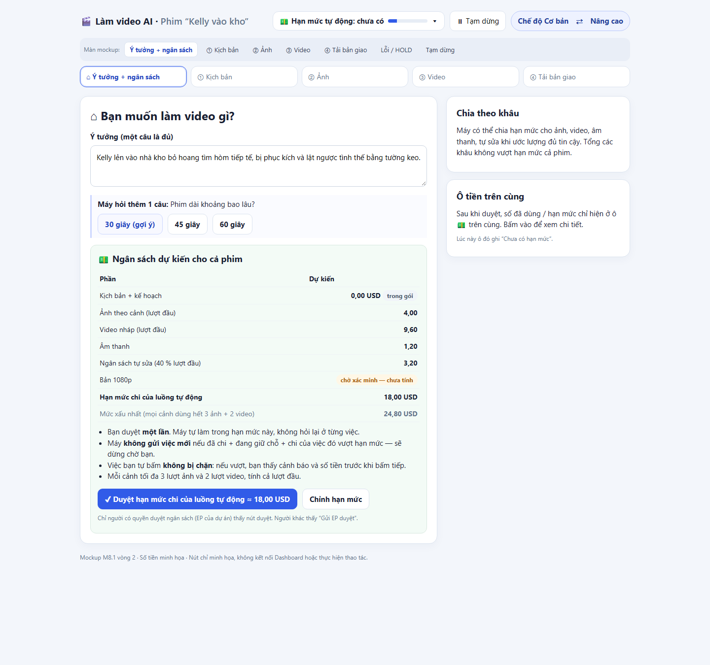
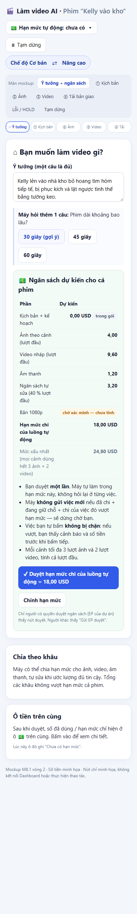
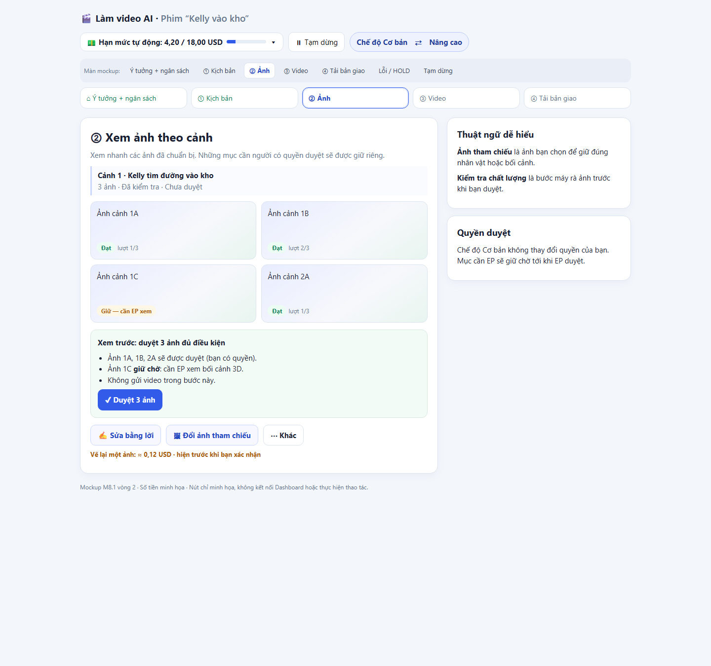
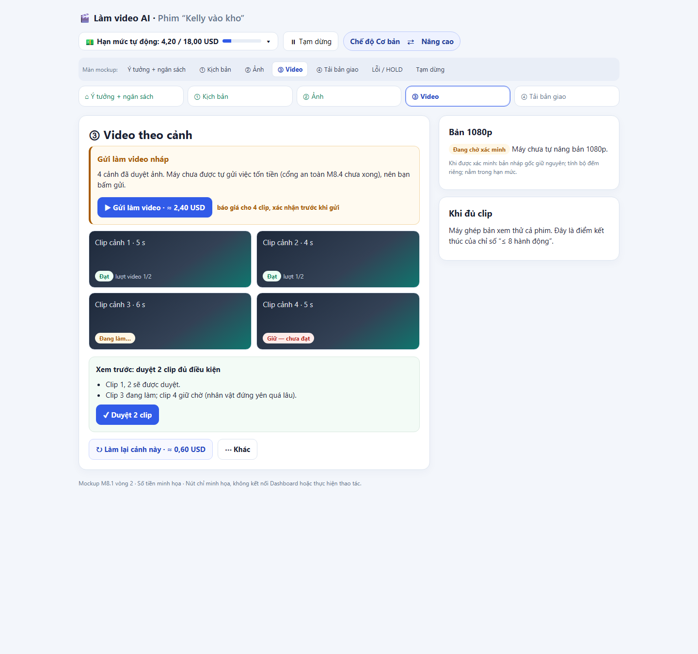
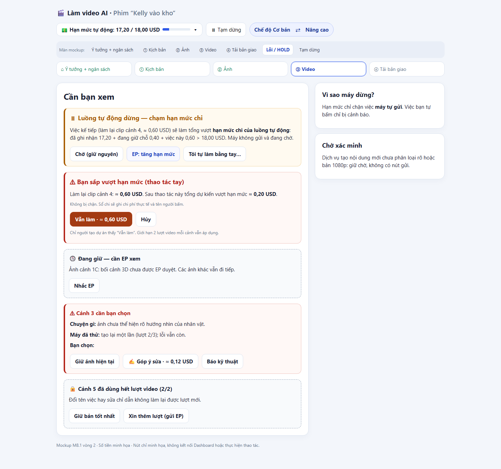
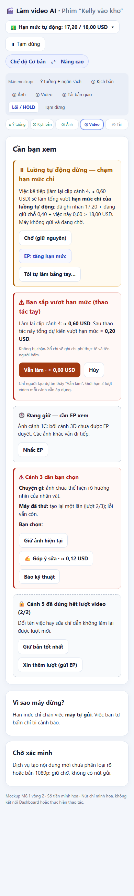
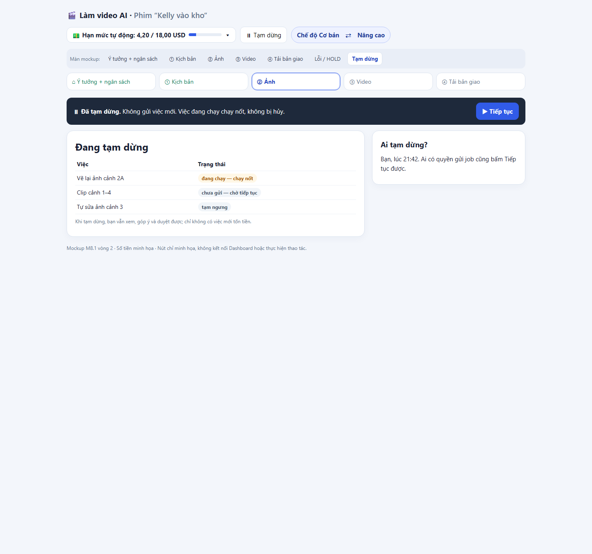

# Thiết kế M8.1 — Chế độ Cơ bản cho Dashboard (vòng 2)

> **Trạng thái: Chấp thuận hướng về nguyên tắc 23/10; EP đã trả lời 5 câu hỏi mở (mục 14) — TRÌNH DUYỆT CHÍNH THỨC M8.1, chưa bắt đầu M8.2.** Bản trình EP duyệt lại · 23/10/2026 · Cấp 1, 0 USD.
> Đây là thiết kế và mockup tĩnh; chưa thay đổi giao diện đang chạy, chưa bật cờ, không gọi API, không đọc dữ liệu dự án thật.
> M8.2 chỉ bắt đầu sau khi EP duyệt chính thức bản này.
>
> **Vòng 2 (23/10 tối) sửa theo góp ý EP:** nhãn Cơ bản / Nâng cao; Q-D theo `ep-2310-qd3-auto-spend-limit-2026-10-23`
> ("hạn mức chi của luồng tự động", thay qd2); tổng tiền chỉ ở một chỗ; cổng M8.4 trước mọi luồng M8 tự động trả phí;
> chốt một điểm kết thúc cho chỉ số "≤ 8 hành động"; mockup đủ màn; bảng đối chiếu nguồn.
>
> Tên file (`…CHE_DO_DON_GIAN…`, `mockup/che_do_don_gian_m81.html`) giữ nguyên để không gãy liên kết; mọi chữ HIỂN THỊ dùng nhãn mới.

## 0. Tên hai chế độ

| Hiển thị trên Dashboard | Tên cũ (chỉ còn trong tài liệu cũ) | Tên nội bộ trong code / cờ — GIỮ NGUYÊN |
|---|---|---|
| **Chế độ Cơ bản** | Đơn giản | cờ `simple_mode`, khóa cấu hình, tên hàm/module có chữ `simple` |
| **Chế độ Nâng cao** | Chuyên gia | giao diện hiện tại (không cờ riêng) |

- Tài khoản **mới** mặc định **Cơ bản**. Tài khoản **đang dùng Chuyên gia** hiển thị nhãn **Nâng cao**, không đổi quyền.
- Chuyển chế độ chỉ đổi **cách trình bày và luồng thao tác**; không đổi quyền truy cập, quyền chi tiêu, quyền duyệt nội dung hay quyền gửi job.
- Không đổi tên cờ `simple_mode` vì đổi tên đụng code/dữ liệu cấu hình; sổ `ep-2310-mode-labels-basic-advanced-2026-10-23` cho phép giữ.

## 1. Mục tiêu

Giúp người mới tạo được video AI qua một luồng ngắn, câu chữ thông thường và các lựa chọn có giải thích. Dashboard tự xử lý việc kỹ thuật
đã được cho phép; người dùng duyệt nội dung và kết quả. Mọi thao tác trả phí hiện báo giá của chính thao tác đó trước khi xác nhận đúng quyền.

## 2. Căn cứ và giới hạn số đo

| Nguồn | Bằng chứng dùng trong thiết kế | Giới hạn |
|---|---|---|
| `docs/KIEM_KE_NUT_DASHBOARD_2026-10-21.md` | Kiểm kê tĩnh tại mốc code 3b58812: 853 điều khiển (439 nút, 414 ô nhập/chọn); 529 điều khiển trên 5 màn sản xuất; luồng tay ước tính ≈ 33 thao tác, ≈ 19 quyết định. | Mốc 21/10, trước M8.0a/b; số thao tác là ước tính theo code, không phải nhật ký người dùng. |
| `devsys/pipeline_maps.json` | 4 màn dây chuyền chính, 28 ô chức năng, 19 hành động có nhãn. | Bản đồ chức năng, không phải đếm widget/lượt bấm. |
| `core/ui_step.py`, `core/ui_log.py`, `dashboard/common.py`, `devsys/pipeline_maps.py` | Có cơ chế `ui_step`/`ui_actions`; cờ `ui_step_log` mặc định TẮT. | Không đọc CSDL/nhật ký thật; chưa có số đo bước, thời gian, lỗi của người dùng. |
| `docs/KE_HOACH_DASHBOARD_DON_GIAN_2026-10-21.md` mục 4, 8c.6, 9, 11 | Luồng bốn bước, mục tiêu ≤ 8 thao tác, ≤ 6 quyết định, câu hỏi Q-A…Q-F. | Mục tiêu thiết kế, chưa thử với người mới. |
| `data/decisions.json` (chỉ các mục EP liệt kê ở mục 13) | Câu trả lời EP 22/10 và góp ý 23/10. | Sổ là căn cứ; thiết kế không tự mở rộng quyết định. |

Không suy ra "nút được dùng nhiều" từ số lần xuất hiện trong mã. Muốn có tần suất thật phải có chấp thuận cho snapshot đã lọc định danh
(chỉ `project_id` giả, tên bước, kết quả, thời lượng) hoặc buổi thử có người tham gia và đồng ý riêng.

## 3. Quyết định EP đã đưa vào

| Mục | Sổ quyết định | Cách áp dụng trong thiết kế |
|---|---|---|
| Q-A — hướng kịch bản | `ep-2210-qa-auto-pick-direction-2026-10-22` | Máy đề xuất 1/3 hướng theo tiêu chí truy vết được (hiện lý do chọn); giữ cả 3 phương án và nút "Phương án khác". Sau khi EP khóa, máy **không** tự đổi phương án. |
| Q-B — chỉ dẫn chuyển động | `ep-2210-qb-motion-prompt-auto-2026-10-22` | Video Prompt Artist viết, Director chấp nhận khi kiểm tra đạt; không đổi BYĐ/dữ liệu khóa. Quyền **chấp nhận** motion prompt tách khỏi quyền **gửi API trả phí** — chấp nhận prompt không làm gửi job. |
| Q-C — bản 1080p | `ep-2210-qc-auto-upscale-1080-2026-10-22` (**PENDING_VERIFICATION**), `ep-2210-upscale-definition-2026-10-22` | **Không bật** tự nâng 1080p tới khi xác minh xong (báo giá, quyền). Mockup chỉ hiện trạng thái "đang chờ xác minh". Khi bật: không thay bản gốc; thiếu quyền/báo giá → HOLD; tính bộ đếm upscale riêng. |
| Q-D — ngân sách | `ep-2310-qd3-auto-spend-limit-2026-10-23` (**thay** `ep-2210-qd2-hard-stop-automated-only-2026-10-22`) | Mục 4. |
| Q-E — nhãn + mặc định | `ep-2310-mode-labels-basic-advanced-2026-10-23` (thay `ep-2210-qe-default-mode-2026-10-22`) | Mục 0. |
| Q-F — an toàn tiền trước | `ep-2210-qf-money-safety-first-2026-10-22` | M8.0 (+ M8.0b) đã trên main; M8.0c (~23 nút thử lại/từ chối/mở lại/giọng/nhạc) còn mở. Chế độ Cơ bản không đưa thao tác chưa có xác nhận thành lối tắt. |
| Cổng M8.4 | `ep-2310-m84-gate-before-auto-paid-2026-10-23` (**PENDING_VERIFICATION** về đánh số) | Mục 6. |
| E2 — "Duyệt hết" | `ep-2210-e2-approve-all-preview-2026-10-22` | Xem trước từng mục cụ thể; áp đúng vai cho từng loại; mục cần EP hoặc chưa đạt → **HOLD** kèm lý do. Không tự khóa Bible / duyệt motion / duyệt sân khấu 3D thay EP. |
| E4 — bộ đếm | `ep-2210-e4-counters-2026-10-22`, `v31-ep-m6-self-repair-budget-40-2026-10-21` | Trần **3 ảnh + 2 video mỗi shot, tính cả lượt đầu**. Lip-sync, upscale: bộ đếm + ngân sách riêng. Provider tạo generation mới chưa phân loại → HOLD xác minh. Đổi tên tác vụ / sửa prompt / đổi model / khởi động lại **không** reset bộ đếm. Ngân sách tự sửa = 40 % chi phí lượt đầu đã duyệt, nằm trong ngân sách dự án. |

Thêm hai ràng buộc chung: **đổi chế độ không đổi quyền**; nút **"Được, làm tiếp"** ở bước Kịch bản chỉ áp cho phần kịch bản và việc chuẩn bị
trong phạm vi đã duyệt — **không** trở thành duyệt thay EP ở các khâu sau (Bible, motion, sân khấu, ảnh, video).

## 4. Ngân sách: "hạn mức chi của luồng tự động" (Q-D theo qd3)

**Trước khi bắt đầu** (màn Ý tưởng + ngân sách):

1. Dashboard tính và hiện **ngân sách dự kiến toàn phim** và **mức trần toàn phim** (dự toán lượt đầu: kịch bản, kế hoạch, ảnh, video nháp,
   bản cao khi Q-C được bật, âm thanh; mức xấu nhất; ngân sách tự sửa 40 %).
2. **Người có quyền duyệt ngân sách** (theo M6 mục 1b hiện là EP của dự án) xác nhận **một lần**. Con số được xác nhận là
   **"hạn mức chi của luồng tự động"** — đúng tên này trên giao diện, để không ai hiểu nhầm là thao tác tay bị chặn.
3. Không hỏi duyệt lại ngân sách toàn phim ở từng job nằm trong phạm vi đã duyệt.

**Luồng tự động** (autopilot, tự sửa, tự nâng 1080p khi bật, mọi job do máy tạo):

- **Không gửi job mới** nếu `chi đã ghi nhận + chi đang giữ chỗ + chi dự kiến của job đó > hạn mức tự động`.
- Khi đó luồng tự động **dừng chờ**, hiện thẻ "Luồng tự động dừng — chạm hạn mức chi" (mục 9), không tự xin thêm tiền.
- Có thể **chia hạn mức theo khâu** (ảnh, video, âm thanh, tự sửa…) khi ước lượng đủ tin cậy; **tổng hạn mức các khâu ≤ hạn mức tự động toàn phim**.
  Chạm hạn mức một khâu chỉ dừng khâu đó.
- Cảnh báo sớm khi dùng tới **80 %** hạn mức (ngưỡng từ Q-D gốc; qd3 không nhắc lại — xem câu hỏi mở 3).

**Thao tác thủ công** (người bấm tay):

- **Không chặn cứng.** Nếu thao tác làm tổng chi vượt hạn mức: hiện cảnh báo kèm **chi phí của thao tác** và **khoản dự kiến vượt**.
- **Người tạo dự án** được bấm tiếp tục. Sổ chi ghi **chi phí thực tế + người thực hiện**.
- Vẫn qua xác nhận giá/quyền hiện hành (M8.0).

**Không đổi:** giới hạn generation mỗi shot (E4), quyền duyệt nội dung, quyền gửi job hiện có, ngân sách tự sửa 40 %.

## 5. Hiển thị tiền — một vị trí cố định

- **Tổng ngân sách dự án chỉ hiện ở MỘT chỗ:** ô "Hạn mức tự động" trên thanh trên cùng (cùng vị trí ở mọi màn), dạng
  `đã dùng / hạn mức` + thanh tiến độ nhỏ. Bấm vào mở **chi tiết**: đã ghi nhận, đang giữ chỗ, chia theo khâu, ngân sách tự sửa, thao tác tay đã vượt (ai, bao nhiêu).
- Bỏ thẻ "Chi phí phim" lặp số ở cột bên (vòng 1 lặp 4,20 / 18,00 USD hai chỗ).
- **Báo giá của thao tác trả phí cụ thể** (vd "Vẽ lại ảnh cảnh 3 · ≈ 0,12 USD") vẫn hiện **ngay tại nút** trước khi xác nhận. Đây là báo giá hành động, không lặp tổng.
- Màn duyệt ngân sách hiện con số **đề xuất** để duyệt (chưa phải tổng đang chạy); ô trên cùng hiện "Chưa có hạn mức" tới khi duyệt.

## 6. Cổng an toàn trước luồng tự động trả phí

Theo `ep-2310-m84-gate-before-auto-paid-2026-10-23`:

- **M8.4 phải HOÀN TẤT trước khi bật bất kỳ luồng M8 tự động gửi API trả phí nào.** M8.0 / M8.0b / M8.0c **không thay thế** cổng này.
- **Ghi theo nghĩa đen M8.4 của kế hoạch chính** (`docs/KE_HOACH_V3_1_MASTER_BUILD_2026-10-20.md`): "Tối ưu theo số đo M8.3" — 10 người, màn chính < 2 s.
  Lưu ý: "M8.4" trong `docs/KE_HOACH_DASHBOARD_DON_GIAN_2026-10-21.md` cũ là **an toàn tiền = M8.0 hiện tại**. Cần EP xác nhận (câu hỏi mở 1).
- Trước khi qua cổng, chế độ Cơ bản vẫn dùng được, nhưng **mọi job trả phí do người bấm gửi** (một nút "Gửi làm video · ≈ X USD" có xác nhận),
  không có job trả phí nào do máy tự gửi.

### Phụ thuộc và điều kiện nghiệm thu (đề xuất ghi vào roadmap)

| Việc | Phụ thuộc | Điều kiện nghiệm thu thêm |
|---|---|---|
| M8.2 Triển khai chế độ Cơ bản (cờ `simple_mode` TẮT) | EP duyệt chính thức M8.1; M8.0 ✅; M8.0c xong trước khi Cơ bản hiện các nút retry/reject/reopen/voice/music | Nhãn "Cơ bản/Nâng cao" mọi chỗ hiển thị; đổi chế độ không đổi quyền (test); tổng tiền một chỗ; "Duyệt hết" theo E2 (HOLD); bộ đếm E4 không reset; **không có đường nào trong M8.2 để máy tự gửi job trả phí** khi M8.4 chưa ✅ (test quét: mọi job trả phí từ Cơ bản đều có actor là người + xác nhận). |
| Luồng tự động trả phí của M8 (M8.6 `simple_autoflow` của kế hoạch 21/10: tự gen ảnh sau "Được, làm tiếp", tự gen/nâng video, tự sửa) | **M8.4 ✅** + M8.0c ✅ + Q-C xác minh (với tự nâng 1080p) + cổng `gen_auth` M6 chặn thật | Cổng hạn mức tự động chặn khi `ghi nhận + giữ chỗ + dự kiến > hạn mức` (test, kể cả chia theo khâu); thao tác tay vượt chỉ cảnh báo + ghi sổ người thực hiện; cờ bật là Cấp 3 riêng. |
| M8.3 Đo tải | — | Đo cả màn Cơ bản (cùng bài 10 người). |
| M8.4 Tối ưu theo số đo | M8.3 | Như cũ (10 người, màn chính < 2 s) + là **cổng** cho luồng tự động trả phí M8. |

## 7. Luồng đề xuất

```text
⌂ Ý tưởng + ngân sách → ① Kịch bản → ② Ảnh → ③ Video → ④ Tải bản giao
  gõ một câu, duyệt       xem/sửa      duyệt ảnh   xem/duyệt clip,   tải
  hạn mức một lần         bằng lời     (E2)        xem bản ghép
```

1. **Ý tưởng và ngân sách:** nhập ý tưởng; hệ thống hỏi thêm chi tiết thiếu bằng câu ngắn có đáp án gợi ý. Hiện ngân sách dự kiến + mức trần
   toàn phim; người có quyền bấm **"Duyệt hạn mức chi của luồng tự động ≈ X USD"** một lần (mục 4).
2. **Kịch bản:** hiện hướng được chọn kèm lý do và "Phương án khác"; đọc theo cảnh, góp ý bằng lời hoặc bấm **"Được, làm tiếp"** (chỉ kịch bản +
   chuẩn bị trong phạm vi; không duyệt thay EP khâu sau).
3. **Ảnh:** lưới theo cảnh. "Duyệt hết" mở **xem trước** danh sách cụ thể: mục đúng vai được duyệt; mục cần EP / chưa đạt → HOLD có lý do.
   "Sửa bằng lời" / "Đổi ảnh tham chiếu" hiện báo giá thao tác trước khi gửi; bộ đếm "lượt ảnh 2/3".
4. **Video:** trước M8.4, người bấm "Gửi làm video · ≈ X USD" (xác nhận). Clip theo cảnh, trạng thái dễ hiểu; duyệt/"Làm lại cảnh này" có giá;
   bộ đếm "lượt video 1/2". Tự nâng 1080p: chờ xác minh Q-C. Đủ clip đã duyệt → máy ghép **bản xem thử**.
5. **Tải bản giao:** xem bản ghép, chọn có/không phụ đề, bấm tải.

## 8. Chỉ số "≤ 8 hành động" — một điểm kết thúc

**Điểm kết thúc đã chọn: tới khi XEM ĐƯỢC video đầu tiên ĐÃ GHÉP (bản xem thử cả phim) trên Dashboard. KHÔNG tính bấm tải bản giao.**

Lý do:
- "Video đầu tiên đã ghép" là lúc người mới thấy kết quả thật; "clip đầu được duyệt" (định nghĩa cũ mục 9 kế hoạch 21/10) dừng quá sớm, bỏ sót bước video còn lại.
- Tải bản giao là một cú bấm cố định ở cả hai chế độ, không phản ánh độ khó của luồng; tính vào chỉ làm nhiễu.
- Đo được bằng một sự kiện rõ (bản ghép xem thử sẵn sàng + người mở xem), không phụ thuộc trình duyệt tải file.

**Áp cùng cho baseline và bài thử:** con số ≈ 33 thao tác / ≈ 19 quyết định (21/10) là ước tính tới "video đầu tiên" chưa định nghĩa chặt —
**phải đếm lại baseline Nâng cao trên cùng bài thử, cùng điểm kết thúc** trước khi so.

Quy ước đếm: một hành động = một lần bấm nút / chọn; gõ chữ không tính; bấm phát video để xem không tính.

| # | Hành động (luồng bình thường, trước M8.4) | Quyết định |
|---|---|---|
| 1 | Gửi ý tưởng | ✔ |
| 2 | Duyệt hạn mức chi của luồng tự động | ✔ |
| 3 | "Được, làm tiếp" (kịch bản) | ✔ |
| 4–5 | "Duyệt hết" ảnh → xác nhận danh sách xem trước | ✔ |
| 6 | "Gửi làm video · ≈ X USD" (bấm tay vì chưa có luồng tự động trả phí) | ✔ |
| 7–8 | "Duyệt hết" clip → xác nhận danh sách → máy ghép bản xem thử | ✔ |

= **8 hành động, 6 quyết định** khi không phải trả lời câu hỏi thêm. Sau M8.4 (nếu EP cho máy tự gửi video trong hạn mức) bỏ được #6 → 7,
chừa 1 cho một câu hỏi làm rõ. **Đây là mục tiêu thiết kế, không phải kết quả đo** — chưa có dữ liệu người dùng.

## 9. Trạng thái lỗi, HOLD và tạm dừng

| Trạng thái | Thẻ hiển thị | Lựa chọn |
|---|---|---|
| Mục cần EP (sân khấu 3D, Bible, motion cần EP) | "Đang giữ — cần EP xem" + lý do; không chặn mục khác | Người không phải EP: "Nhắc EP". EP: mở mục để duyệt riêng (có tên người duyệt). |
| Mục chưa đạt kiểm tra | "Đang giữ — chưa đạt: …" (chữ thường) | Sửa bằng lời (có giá) · Giữ bản hiện tại · Báo kỹ thuật |
| Luồng tự động chạm hạn mức (toàn phim hoặc một khâu) | "Luồng tự động dừng — chạm hạn mức chi" + đã ghi nhận / giữ chỗ / job kế dự kiến | Chờ (mặc định) · EP tăng hạn mức (duyệt lại) · Làm tiếp bằng tay (cảnh báo) |
| Thao tác tay sẽ vượt hạn mức | Cảnh báo: chi phí thao tác + khoản dự kiến vượt + "sổ chi ghi tên bạn" | Người tạo dự án: "Vẫn làm" · Hủy. Không chặn cứng. |
| Hết lượt E4 (3 ảnh / 2 video) | "Cảnh này đã dùng hết lượt" | Giữ bản tốt nhất · Xin thêm lượt (gửi EP) · Báo kỹ thuật |
| Provider chưa phân loại / chờ xác minh (Q-C) | "Đang chờ xác minh" | Không có nút gửi |
| Tạm dừng | Biểu ngữ "Đã tạm dừng — không gửi job mới; job đang chạy chạy nốt, không bị hủy" | Tiếp tục · Xem việc đang chạy |

Thẻ lỗi dùng cấu trúc **"Chuyện gì — Máy đã thử gì — Bạn chọn"**, không lộ exception/mã kỹ thuật; hết lượt tự sửa thì không tự chi thêm.
Mỗi thẻ cảnh có bốn lối: "Được", "Sửa bằng lời", "Đổi ảnh tham chiếu", "Khác". Đổi dữ liệu không âm thầm ghi đè bản đã duyệt; trước khi chạy lại
hiện đầu ra nào sẽ cũ và báo giá.

## 10. Bảng giữ, gộp, ẩn và tự động

| Khu vực / điều khiển hiện tại | Cơ bản | Lý do và thay thế |
|---|---|---|
| "Bắt đầu dự án mới", danh sách dự án, tải bản hoàn tất | **GIỮ** | Điểm vào quen thuộc. |
| 12 ô thiết lập, JSON tay, phân tích, biểu mẫu kỹ thuật | **GỘP / ẨN** | Câu hỏi hội thoại có mặc định; thiết lập đầy đủ ở Nâng cao. |
| Bốn lượt Biên kịch, radio ba hướng | **GỘP** | Một nút "Viết kịch bản"; máy đề xuất một hướng có lý do; giữ "Phương án khác" (Q-A). |
| "Dùng kịch bản", "Lập kế hoạch", "Duyệt & khóa" | **GỘP có phạm vi** | "Được, làm tiếp" chỉ cho kịch bản/chuẩn bị; không duyệt thay EP khâu sau. |
| blocking, end_state, BYĐ, model, cờ, tên provider | **ẨN** | Góp ý bằng lời; chú giải một dòng khi cần. |
| "Gen ảnh", nút motion/giọng, mức QC, sửa prompt tiếng Anh | **Trước M8.4: GỘP, người bấm gửi có giá · Sau M8.4: TỰ ĐỘNG trong hạn mức** | Q-B: chấp nhận prompt ≠ gửi job trả phí. |
| Duyệt từng ảnh / "Duyệt tất cả" | **GIỮ / GỘP có xem trước** | E2: danh sách cụ thể, đúng vai, HOLD mục chưa đủ điều kiện. |
| "Vẽ lại", chọn ảnh tham chiếu, bản cũ | **GIỮ cốt lõi** | "Sửa bằng lời", "Đổi ảnh"; báo giá tại nút; bộ đếm lượt hiện trên thẻ. |
| Model, độ phân giải, gói gửi, cổng kỹ thuật | **ẨN** | Chỉ Nâng cao; ngoại lệ thành thẻ "Cần bạn". |
| Duyệt clip, làm lại, nâng bản cao | **GIỮ / chờ xác minh** | Nâng 1080p tự động chỉ sau xác minh Q-C và sau cổng M8.4. |
| Nhạc, SFX, TTS, phụ đề, 117 điều khiển hậu kỳ | **GỘP / ẨN** | "Có/không phụ đề" + vài lựa chọn nhạc; bảng kỹ thuật ở Nâng cao. |
| Thanh trên: mức tự động, tính năng thử, kho, cờ, sổ chi | **ẨN / GIỮ** | Giữ tên phim, **ô hạn mức tự động (chỗ tiền duy nhất)**, Tạm dừng, công tắc "Cơ bản ⇄ Nâng cao". |

## 11. Ngôn ngữ trên màn

| Thuật ngữ hiện tại | Chữ trong chế độ Cơ bản |
|---|---|
| BYĐ | Ý đồ của cảnh |
| plate / nền 3D | Ảnh bối cảnh |
| ref / reference | Ảnh tham chiếu |
| motion prompt | Chỉ dẫn chuyển động |
| storyboard | Bộ ảnh theo cảnh |
| multi-shot | Clip nhiều cảnh nhỏ |
| QC | Kiểm tra chất lượng |
| Lock / Bible | Hồ sơ nhân vật đã duyệt |
| hard stop / budget cap (luồng máy) | Hạn mức chi của luồng tự động |
| Seedance / Kling / tên model | Ẩn; chỉ nêu tên dịch vụ khi xử lý sự cố |
| Mã cờ / exception | Ẩn; thay bằng mô tả và bước tiếp theo |

## 12. Kiểm chứng sau khi EP duyệt

1. M8.2 dựng đúng khung màn, cờ `simple_mode` TẮT tới nghiệm thu; Nâng cao hoạt động như hiện tại.
2. M8.0c xong trước khi Cơ bản hiện thêm nút tốn tiền chưa được bảo vệ. M8.4 xong trước mọi luồng M8 tự động trả phí.
3. Thử với người chưa có kinh nghiệm trên dự án giả: số hành động/quyết định tới **video đầu tiên đã ghép** (mục 8), số lần hỏi lại, thời gian,
   số lần mở "Khác", lỗi thao tác, mức hiểu giá. Không lấy số ước tính ở mục 8 làm kết quả.
4. Test quyền/actor cho từng thao tác duyệt; E2 giữ HOLD; đổi chế độ không đổi quyền; mọi đường gửi tiền có báo giá + xác nhận; luồng tự động
   không vượt hạn mức; thao tác tay vượt chỉ cảnh báo và ghi sổ người thực hiện; bộ đếm E4 không reset khi đổi tên/prompt/model.
5. Mục tiêu: ≤ 8 hành động, ≤ 6 quyết định, 0 đường gửi tiền không báo giá/xác nhận. Thời gian đo riêng; chưa đặt ngưỡng vì chưa có baseline nhật ký an toàn.

## 13. Đối chiếu nguồn

Trạng thái chung: **Chấp thuận hướng về nguyên tắc 23/10; EP đã trả lời 5 câu hỏi mở (mục 14) — TRÌNH DUYỆT CHÍNH THỨC M8.1, chưa bắt đầu M8.2.**

| Điểm EP | Sổ quyết định (`data/decisions.json`) | Roadmap (`KE_HOACH_V3_1_MASTER_BUILD_2026-10-20.md`) | Tài liệu gốc | Mục trong thiết kế |
|---|---|---|---|---|
| Nhãn Cơ bản / Nâng cao, mặc định, không đổi quyền | `ep-2310-mode-labels-basic-advanced-2026-10-23` (thay `ep-2210-qe-default-mode-2026-10-22`) | dòng M8.1, M8.2 | `KE_HOACH_DASHBOARD_DON_GIAN_2026-10-21.md` mục 3, 11 (Q-E) | 0 |
| Hạn mức chi của luồng tự động; thủ công chỉ cảnh báo | `ep-2310-qd3-auto-spend-limit-2026-10-23` (thay `ep-2210-qd2-hard-stop-automated-only-2026-10-22`); giữ `budget-gate-removed-2026-10-15`, `v31-d01b-money-policy-product-job-cap-2026-10-20` | dòng M8.1 (Q-D), M8.2 | `KE_HOACH_DASHBOARD_DON_GIAN_2026-10-21.md` mục 4 (💵), 11 (Q-D); `KE_HOACH_TO_LAM_PHIM_CO_CHU_2026-10-21.md` mục 1b (quyền duyệt ngân sách), 4b (giữ D01b cho thao tác EP) | 4, 9 |
| Tổng tiền một chỗ, báo giá hành động tại nút | `ep-2310-qd3-auto-spend-limit-2026-10-23` (đặt tên trên UI); `ep-2210-qf-money-safety-first-2026-10-22` (giá + xác nhận) | dòng M8.0 | góp ý EP 23/10 (chat) | 5 |
| Cổng M8.4 trước luồng tự động trả phí | `ep-2310-m84-gate-before-auto-paid-2026-10-23` (PENDING_VERIFICATION đánh số); giữ `ep-2210-qf-money-safety-first-2026-10-22` | dòng M8.2, M8.4 | `KE_HOACH_DASHBOARD_DON_GIAN_2026-10-21.md` mục 10 ("M8.4" cũ = an toàn tiền) | 6 |
| Q-A đề xuất 1/3 hướng | `ep-2210-qa-auto-pick-direction-2026-10-22` | dòng M8.1 | `KE_HOACH_DASHBOARD_DON_GIAN_2026-10-21.md` mục 11 | 3, 7 |
| Q-B tách chấp nhận prompt / gửi API | `ep-2210-qb-motion-prompt-auto-2026-10-22` | dòng M8.1; M6.5 | `KE_HOACH_TO_LAM_PHIM_CO_CHU_2026-10-21.md` mục 3 (VPA) | 3, 10 |
| Q-C 1080p chờ xác minh | `ep-2210-qc-auto-upscale-1080-2026-10-22` (PENDING_VERIFICATION); `ep-2210-upscale-definition-2026-10-22` | dòng M8.1 | `KE_HOACH_DASHBOARD_DON_GIAN_2026-10-21.md` mục 11 | 3, 7, 9 |
| E2 "Duyệt hết" xem trước, đúng vai, HOLD | `ep-2210-e2-approve-all-preview-2026-10-22`; giữ `v31-ep-stage-desk-actions-2026-10-21` | dòng M8.0 (M8.0b), M8.1 | `KE_HOACH_TO_LAM_PHIM_CO_CHU_2026-10-21.md` mục 1b | 3, 9 |
| E4 trần 3 ảnh + 2 video, bộ đếm riêng, không né | `ep-2210-e4-counters-2026-10-22`; `v31-ep-m6-self-repair-budget-40-2026-10-21`; `v31-m6-generation-limits-policy-b-2026-10-21` | M6 (Generation Authorization) | `KE_HOACH_TO_LAM_PHIM_CO_CHU_2026-10-21.md` mục 4 | 3, 9 |
| "Được, làm tiếp" không duyệt thay EP | `ep-2210-e2-approve-all-preview-2026-10-22`; `ep-2210-g1b-ep-role-package-approved-2026-10-22` | dòng M8.1 | `KE_HOACH_TO_LAM_PHIM_CO_CHU_2026-10-21.md` mục 1b | 3, 7 |
| Chỉ số ≤ 8 hành động, một điểm kết thúc | `ep-2310-m81-r2-answers-2026-10-23` | dòng M8.1 | `KE_HOACH_DASHBOARD_DON_GIAN_2026-10-21.md` mục 4, 8c.6, 9 | 8 |

## 14. Câu hỏi đã được EP trả lời (23/10, sổ `ep-2310-m81-r2-answers-2026-10-23`)

1. **Cổng M8.4** = M8.4 kế hoạch chính (Tối ưu theo số đo M8.3 — 10 người, màn chính < 2 s), đúng như roadmap. M8.0/M8.0c không thay thế.
2. **Điểm kết thúc chỉ số** = xem được video đầu tiên đã ghép; KHÔNG tính bấm tải bản giao (mục 8). Áp cùng cho baseline và bài thử.
3. **Giữ cảnh báo sớm 80 %** của hạn mức chi của luồng tự động.
4. **Chia hạn mức theo khâu** chỉ khi ước lượng đủ tin cậy; **mặc định một hạn mức chung** cho cả phim.
5. **Vượt hạn mức bằng tay:** không chặn; **báo EP sau** (thông báo + dòng sổ chi có người thực hiện, chi phí thực tế, khoản vượt).

## 15. Bản vẽ

Mockup HTML tĩnh: [`mockup/che_do_don_gian_m81.html`](../mockup/che_do_don_gian_m81.html) — một file, chạy offline, chuyển màn bằng tab
(hoặc `#y-tuong`, `#kich-ban`, `#anh`, `#video`, `#tai`, `#hold`, `#tam-dung`). Các nút chỉ minh họa; không kết nối Dashboard, provider,
ngân sách hay dữ liệu dự án. Số tiền trong mockup là số minh họa.

Ảnh chụp (Chrome headless):

| Màn | Rộng 1440 | Hẹp 390 |
|---|---|---|
| Ý tưởng + ngân sách |  |  |
| Ảnh |  | — |
| Video |  | — |
| Lỗi / HOLD |  |  |
| Tạm dừng |  | — |

## 16. Nguồn

- `docs/KE_HOACH_DASHBOARD_DON_GIAN_2026-10-21.md` — nguyên tắc, luồng, đếm thao tác, chỉ số, câu hỏi EP.
- `docs/KE_HOACH_TO_LAM_PHIM_CO_CHU_2026-10-21.md` — M6: quyền (1b), VPA (3), Generation Authorization + ngân sách tự sửa (4).
- `docs/KIEM_KE_NUT_DASHBOARD_2026-10-21.md` — kiểm kê điều khiển 21/10.
- `docs/KE_HOACH_V3_1_MASTER_BUILD_2026-10-20.md` — bảng việc M8.
- `data/decisions.json` — các mục ở mục 13.
- `docs/RA_CX23_M81_CODEX_2026-10-23.md` — báo cáo vòng 1 + vòng 2.
